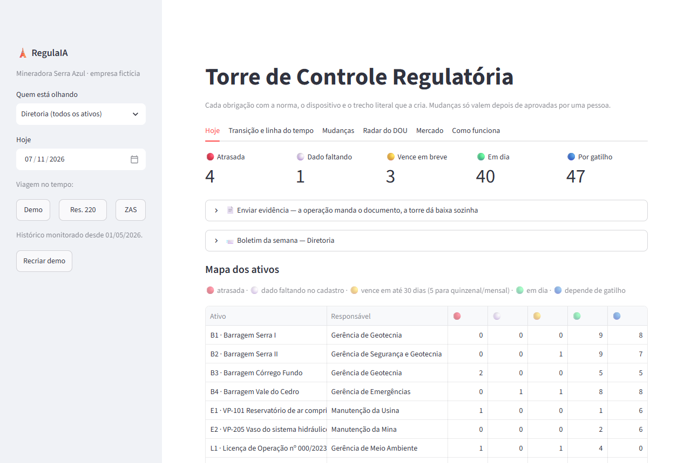
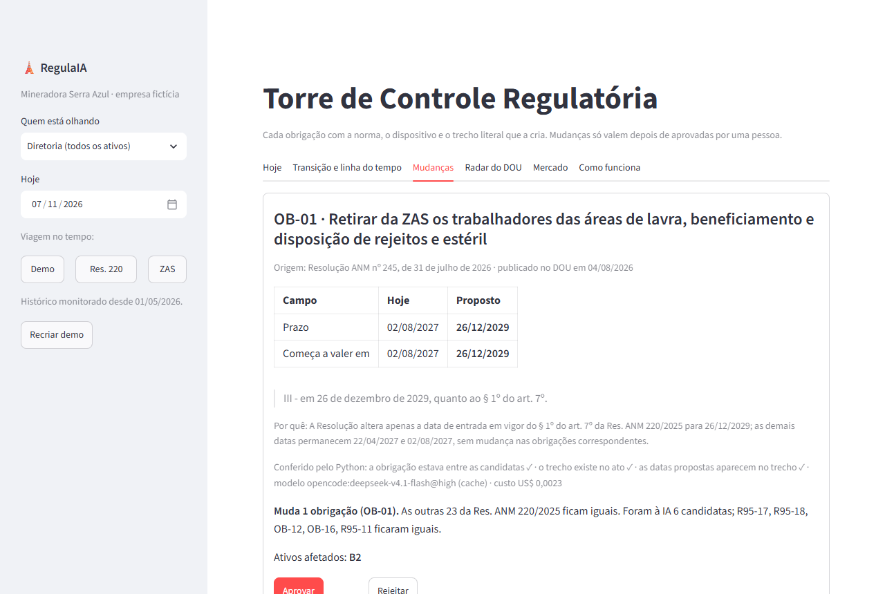
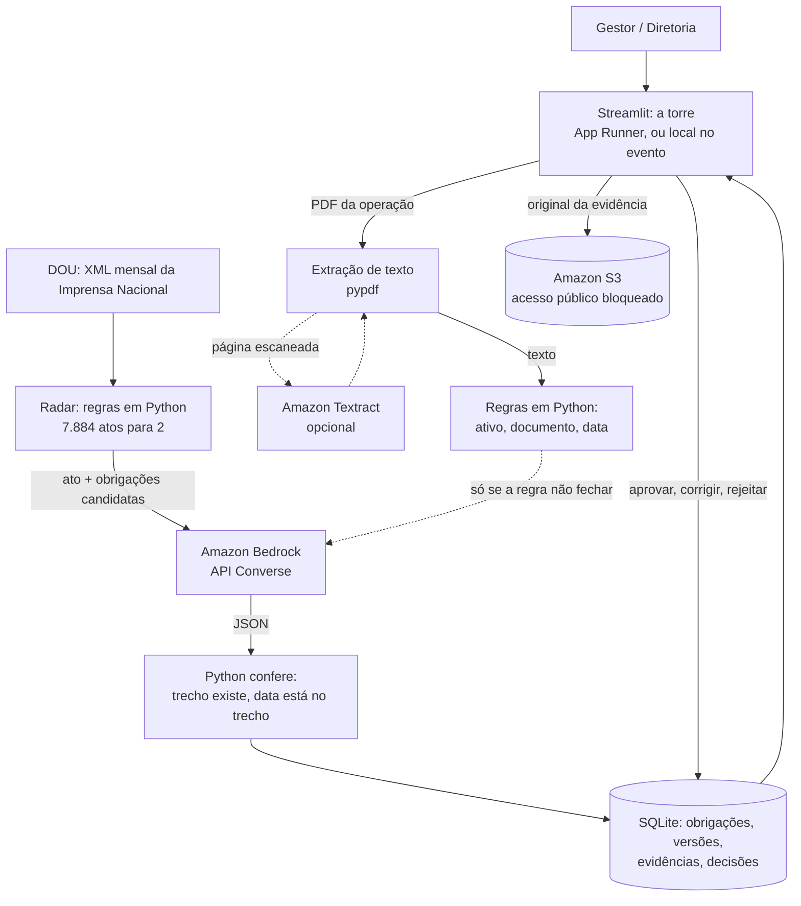

# RegulaIA: torre de controle regulatória para mineração

Hackathon VX, Desafio 02. Rio de Janeiro, 7 e 8 de novembro de 2026.

A torre mostra, para cada ativo de uma mineradora, tudo o que ele precisa cumprir hoje: a obrigação, a norma, o artigo, o trecho literal que a cria, quando vence e se já foi comprovada. Os ativos podem ser:

- barragem;
- vaso de pressão;
- unidade de mineração;
- licença ambiental.

Ela se atualiza por dois caminhos:

- **norma nova:** o radar lê o Diário Oficial, acha o ato que mexe numa obrigação e propõe a mudança, que uma pessoa aprova;
- **documento da operação:** uma FIR, um laudo ou um boletim vira evidência, e a obrigação fica em dia.

Cada gestor vê só os seus ativos e ninguém precisa ler norma nenhuma.



## A demo

A Mineradora Serra Azul é fictícia, mas os perfis das quatro barragens vêm do SIGBM. A empresa tem 8 ativos e 129 obrigações cadastradas, em 7 de novembro de 2026:

As abas seguem quem usa: a operação (caixa de entrada, ativos, entregas), o regulatório (mudanças, radar, transição) e o "sobre" do pitch. Um número, um item da caixa ou uma linha do mapa levam direto à tela certa, já filtrada.

| Aba | O que mostra |
|---|---|
| **Caixa de entrada** | O que precisa de decisão ou ação, cada item com o botão que resolve: mudança de norma aguardando aprovação (**Decidir →**), atrasadas e vencendo (**Registrar entrega**, num diálogo com comprovante opcional), dado faltando (**Completar cadastro**, na ficha do ativo). Os cinco números do topo (atrasada, dado faltando, vence em breve, em dia, por gatilho, cada um com sua cor) abrem a aba Entregas já filtrada. Também recebe documentos: o PDF de uma FIR dá baixa na quinzena, e uma anomalia que obriga Inspeção de Segurança Especial dispara o aviso: pontuação 10 pela Res. 95, EC = 5 pela Res. 220. Registrada, a anomalia abre a ISE do ativo, que fica atrasada até chegar o relatório da inspeção. Gera o boletim da semana de cada gestor (PDF ou texto) e um calendário .ics com os vencimentos e um lembrete no dia em que a obrigação fica amarela (só download; nada é enviado) |
| **Ativos** | O mapa das barragens e instalações, cada ponto com a cor do pior status (na demo, posições fictícias; empresa importada do SIGBM fica sem mapa, porque o arquivo público vai sem coordenadas), a tabela dos ativos (contagem por status) e, ao clicar num ponto ou numa linha, a ficha do ativo: pendências com o trecho literal da norma e o botão de entrega, todas as obrigações, o que comprova (últimas evidências) e o cadastro, onde se preenche o dado que falta. Também a visão por norma e órgão |
| **Entregas** | O dia a dia: filtros (status, ativo, norma, responsável, texto, prazo), seleção de uma ou várias obrigações para registrar a entrega (com comprovante opcional), passar para outro responsável ou comentar, com o histórico de quem fez o quê. Calendário do mês clicável (cada dia com a cor do pior vencimento; o dia clicado lista os vencimentos com o botão de entrega), exportação para Excel e .ics, e a prévia do boletim de cada responsável |
| **Regulatório → Mudanças** | Versões propostas por atos novos, com antes/depois, o trecho do ato e a conferência do Python. Só valem depois de aprovadas. Embaixo, o histórico de cada obrigação: todas as versões, a origem e quem decidiu |
| **Regulatório → Radar do DOU** | O funil de um mês do DOU (7.884 atos → 825 da ANM → 2 candidatos → 1 mudança) e o custo real da IA. Embaixo, "Teste com um ato seu": cole qualquer texto e veja a triagem, a análise e a conferência, e mande para aprovação |
| **Regulatório → Transição e linha do tempo** | O que muda quando a Res. ANM 220/2025 substitui a Res. 95/2022 (2/8/2027), por tema: o que continua, o que é novo, o que deixa de valer para aquele ativo (e por quê: "só para DPA2 ≥ 4"), com o plano de transição para baixar em PDF. A linha do tempo é um Gantt: uma barra por norma em cada ativo até 2030, losangos nas datas em que obrigações passam a valer (laranja quando a data vem de mudança ainda não aprovada); clicar num losango abre a lista daquele dia |
| **Sobre → Mercado** | Barragens e empresas no SIGBM (com fonte), por que agora e uma conta de receita com premissas ajustáveis |
| **Sobre → Como funciona** | Diagrama dos dois fluxos (norma → torre e documento → torre) com os números da demo e as três garantias: a IA não decide sozinha, regra antes de IA, traga sua chave |

**Sua mineradora em 30 segundos.** O botão **➕ Sua mineradora (SIGBM)** na barra lateral busca uma empresa real pelo CNPJ ou pelo nome no SIGBM público e monta a torre com as barragens dela. A torre não presume o que o SIGBM não diz: pontuação do DPA, trabalhadores na ZAS, mapa de inundação validado, potencial de dano ambiental (a classificação estadual de MG, que define a auditoria anual, bienal ou trienal), alteamento contínuo, modificação estrutural e a data da última RPSB aparecem como **dado faltando**, para a empresa preencher. Embargo, nível de emergência e DCE ou DCO não atestada no SIGBM aparecem como alerta. A cobrança começa na data escolhida: o que venceu antes não vira atraso inventado. O arquivo [data/sigbm_barragens_pj.csv](data/sigbm_barragens_pj.csv) tem só as linhas de empresa (CNPJ) do export público, sem CPF e sem coordenadas, e é gerado por `uv run python -m regulaia.sigbm extrair`.

**Contas e acessos.** Para entrar na torre é preciso uma conta, e o que cada pessoa vê vem do papel dela:

| Papel | O que vê e faz |
|---|---|
| **TI** | Só a página **Usuários e acessos**: cria contas, muda papel e área, desativa e troca senha. Não vê dado regulatório. A torre nunca fica sem uma conta de TI ativa |
| **Diretoria** | Todos os ativos. Decide qual área responde por cada ativo, na ficha do ativo (aba Cadastro) |
| **Regulatório** | Todos os ativos (é quem aprova as mudanças de norma) |
| **Gestor de área** | Só os ativos e as obrigações da sua área, sem seletor de visão |

A **conta de teste** troca de visão pela barra lateral ("Quem está olhando": Diretoria, cada gestor ou a TI) e é a única que vê **Recriar demo**. O botão **Entrar na demo** da tela de entrada usa a conta de teste da Serra Azul, que não tem senha. As outras contas da demo estão em [data/usuarios_demo.json](data/usuarios_demo.json), todas com a senha desse arquivo. No link público, troque essa senha por `REGULAIA_SENHA_DEMO` nos *Secrets*. A senha fica guardada com scrypt e sal próprio, e o que se faz na torre (entrega, aprovação, troca de área) fica assinado com o nome da conta. As contas não somem no **Recriar demo**. Somem se o servidor recomeçar do zero, como no Streamlit Cloud: aí voltam só as da demo.

**Caso principal.** A Res. ANM 245/2026 adiou o art. 7 §1 da Res. 220/2025 de 2/8/2027 para 26/12/2029. Esse parágrafo tira as áreas de lavra, beneficiamento e disposição de rejeitos das estruturas associadas à barragem, e quem trabalha nelas deixa de poder ficar na Zona de Autossalvamento (ZAS). Um sistema correto muda essa obrigação e deixa as outras 23 da Res. 220 iguais. A NR-22 (Portaria MTE 105/2026, item 22.24.8) dá a mesma data para barragens não alteadas a montante, também sobre quem pode ficar na ZAS. A linha do tempo mostra as duas normas, ANM e MTE, convergindo.



## O que está cadastrado

| Arquivo | Norma | Obrigações |
|---|---|---|
| [cadastro/lei12334.csv](cadastro/lei12334.csv) | Lei 12.334/2010, a Política Nacional de Segurança de Barragens (com a Lei 14.066/2020) | 23 |
| [cadastro/lei_mg_23291.csv](cadastro/lei_mg_23291.csv) | Lei MG 23.291/2019, a política estadual de segurança de barragens (só para barragens em MG) | 18 |
| [cadastro/dec_mg_48078.csv](cadastro/dec_mg_48078.csv), [dec_mg_48140.csv](cadastro/dec_mg_48140.csv) | Decretos MG 48.078/2020 (PAE) e 48.140/2021 (classificação, auditoria, descaracterização), que regulamentam a lei | 16 |
| [cadastro/res95_2022.csv](cadastro/res95_2022.csv) | Res. ANM 95/2022 (vale até 1/8/2027) | 21 |
| [seed_obligations.csv](seed_obligations.csv) | Res. ANM 220/2025 (vale a partir de 2/8/2027) | 24 |
| [cadastro/nr13.csv](cadastro/nr13.csv) | NR-13, vasos de pressão (Tabela 2, por categoria) | 10 |
| [cadastro/nr22.csv](cadastro/nr22.csv), [nr22_zas.csv](cadastro/nr22_zas.csv) | NR-22, mineração | 11 |
| [cadastro/lo_serra_azul.csv](cadastro/lo_serra_azul.csv) | Licença de operação fictícia e LC 140/2011 | 6 |

Cada obrigação tem três campos que a máquina lê:

- **regra:** a quais ativos se aplica (ex.: `dpa = alto`, `metodo_construtivo != montante e trabalhadores_zas`);
- **agenda:** quando vence (ex.: `quinzenal+15d`, `anos:3`, `unica`);
- **trecho:** o texto literal da norma.

Os 123 trechos das normas oficiais são conferidos por teste (`tests/test_trechos.py`) contra os textos baixados das fontes oficiais (ANMlegis, gov.br/trabalho-e-emprego, Câmara dos Deputados e Assembleia de Minas). A lista das fontes está em `regulaia/fontes.py`. A licença é fictícia e não tem texto para conferir.

O cadastro sai das normas assim: a IA propõe as obrigações a partir do texto (`regulaia/extrator.py`), uma pessoa escolhe e ajusta (`curadoria/*.csv`) e o script gera o CSV final (`regulaia/curadoria.py`). Repetir o processo dá o mesmo resultado.

## Descoberta: as normas que a carteira precisa e o catálogo ainda não tem

O catálogo é da plataforma, e o radar do DOU pega a norma nova. A descoberta (`regulaia/descoberta.py`) responde a outra pergunta: das normas já publicadas, quais valem para os ativos das clientes e ainda não foram catalogadas?

1. **Perfil:** dos ativos de todas as clientes sai o que cobrir, por jurisdição e tipo de ativo (barragem em MG, unidade no Brasil, vaso de pressão no Brasil...).
2. **Fontes oficiais com dados abertos**, ano a ano: o Senado (leis e decretos federais desde 1967), o ANMlegis (resoluções da ANM, com a revogada marcada) e a Assembleia de Minas (a legislação mineira desde 1989, com a situação de vigência).
3. **Camada 0, sem IA:** fica a norma vigente que cita os termos de um tipo de ativo da carteira ([regulaia/temas.toml](regulaia/temas.toml)); crédito orçamentário, homenagem e concessão de lavra a uma empresa saem pela regra. Uma segunda passada traz a norma que regulamenta ou altera uma candidata pela citação na ementa: é assim que entra o Decreto 9.406/2018, que regulamenta o Código de Mineração sem nenhuma palavra de mineração na ementa.
4. **Triagem pela IA**, pela ementa: a norma cobra algo de quem opera o ativo? De qual tipo? Descarte com confiança abaixo de 0,85 é relido pelo texto oficial (ALMG e ANMlegis; a lei federal, pelo texto atualizado da Câmara). A ementa de "Institui a Política Estadual dos Atingidos por Barragens" parece só organização do Estado; o dever da mineradora está no corpo da lei.
5. **Curadoria RegulaIA** aprova (segue para o extrator e a curadoria do catálogo) ou descarta, com nome e nota.
6. **Cobertura por cliente:** o que está no catálogo, o que espera triagem ou curadoria, até quando cada fonte foi lida e as lacunas conhecidas. Estado sem fonte automática aparece como "cobertura não verificada", nunca como coberto. O LexML, que indexa todos os estados, bloqueia acesso automático com verificação anti-robô e não é usado.

Rodada de verdade para a carteira da demo (barragens e unidade em MG, equipamentos): 103.014 normas lidas, 579 candidatas, 149 relevantes para a curadoria, 284 descartadas pela IA com o motivo, 140 revogadas e 6 já no catálogo. A vigência vem da ficha da norma na Câmara (ou do detalhe no Senado, para decreto recente): das 140 revogadas, 18 a IA tinha marcado relevante, e saem da fila com a norma revogadora na nota ([regulaia/vigencia.py](regulaia/vigencia.py)). Custo da triagem: US$ 0,28. A releitura pelo texto trouxe de volta 5 descartadas, entre elas a Lei MG 23.795/2021 (a mineradora custeia a assessoria técnica dos atingidos, art. 3º, VIII). A fila está em [data/descoberta_demo.json](data/descoberta_demo.json) e entra na demo. Entre as relevantes estão a Lei 14.755/2023 (direitos das populações atingidas por barragens), a Lei 9.433/1997 (outorga de uso da água), a Res. ANM 68/2021 (plano de fechamento de mina), o Decreto 9.406/2018 e as normas da CFEM.

Na torre: **Regulatório → Cobertura normativa** mostra, para a cliente, uma linha por jurisdição e tipo de ativo (verde coberta, sempre com as lacunas ao lado; amarelo esperando triagem, curadoria ou extração; cinza "cobertura não verificada"), com as normas do catálogo, as fontes lidas ("Assembleia de Minas, 1989–2026, lida em ...") e as normas já publicadas que ainda esperam. **Normas candidatas** é a fila da curadoria RegulaIA (só a plataforma): o que a IA disse (deveres, motivo, confiança, modelo, se leu o texto oficial), o link do texto, o aviso de quem altera norma do catálogo, e Aprovar / Descartar com nota, na auditoria. A busca e a triagem são job, não rota: `python -m api.jobs descoberta` (ou `docker compose run --rm descoberta`).

```bash
uv run python -m regulaia.descoberta buscar                 # lê as fontes (cache em data/raw/fontes/)
uv run python -m regulaia.descoberta triar --paralelo 6     # IA nas candidatas novas
uv run python -m regulaia.descoberta cobertura "Mineradora Serra Azul"
uv run python -m regulaia.descoberta decidir BR:LEI:14755/2023 aprovar curadoria@regulaia.demo "extrair"
uv run python -m api.jobs descoberta                        # buscar + triar, como job (sai com 1 se uma fonte falhou)
```

## O que os testes garantem

| Garantia | Teste |
|---|---|
| A Res. 245 muda só a OB-01, e só na B2; a Res. 246 não muda nada | `tests/test_impacto.py` (e `tests/test_ia_real.py` com o modelo de verdade) |
| A IA não inventa: trecho que não está no ato ou data que não está no trecho é reprovado | `test_trecho_inventado_e_reprovado…`, `test_data_que_nao_esta_no_trecho…`, `test_ia_nao_pode_inventar_data` |
| Ato sem relação com o cadastro não chama a IA; resposta repetida vem do cache, mesmo sem chave | `test_ato_sem_relacao_nao_chama_a_ia`, `test_cache_vale_mesmo_sem_chave` |
| Cada trecho citado no cadastro existe no texto oficial (123 trechos) | `tests/test_trechos.py` |
| Anomalia abre a ISE e ela só fecha com o relatório; na Res. 220 a regra é a do art. 42 | `tests/test_evidencias.py` |
| ANM e MTE vencem juntas na ZAS depois de aprovada a Res. 245; sem aprovação, nada muda | `test_zas_aprovada_vence_junto_com_a_nr22_no_painel` |
| Os números da documentação, do roteiro e da análise de mercado batem com o cadastro, a demo, o DOU e o SIGBM | `tests/test_documentacao.py`, `test_numeros_do_funil_na_tela_e_nos_documentos`, `test_numeros_da_analise_de_mercado_saem_dos_dados` |
| O boletim não contradiz o amarelo da tela; o PDF sai sem emoji quebrado nem marcação crua | `test_boletim_bate_com_o_amarelo_da_torre`, `tests/test_pdf.py` |
| Cada gestor só vê os ativos dele, em todas as abas (texto, tabelas e títulos), e não registra documento de ativo de outro gestor | `test_cada_gestor_so_ve_os_ativos_dele`, `test_gestor_nao_registra_documento_de_ativo_alheio` |
| No Postgres, a API não vaza conexão: o pool volta ao mínimo, e requisição que cai no meio não deixa transação aberta para a próxima | `tests/test_pool.py` |
| A equipe RegulaIA só lê os dados da cliente: entrega, comprovante, evidência, comentário, atribuição e cadastro dão 403 para a plataforma e passam para a própria empresa; nenhuma ferramenta do agente escreve | `test_plataforma_so_le_os_dados_operacionais_da_empresa`, `test_a_propria_empresa_escreve_nos_dados_dela`, `test_nenhuma_ferramenta_escreve_na_torre` |
| Empresa importada do SIGBM não ganha atraso inventado; o que o SIGBM não informa vira dado faltando, e preencher tira do dado faltando | `tests/test_sigbm.py`, `test_importar_mineradora_do_sigbm_e_operar` |
| Passou do teto de gasto de IA do dia, só regra e cache; o que já foi pago continua valendo | `test_teto_diario_de_ia_corta_chamada_paga_mas_nao_o_cache` |
| A imagem Docker leva o que a demo precisa e deixa de fora `.env` e dados brutos | `test_imagem_docker_leva_o_que_a_demo_precisa_e_nada_secreto` |
| A descoberta lê as três fontes reais, deixa fora revogada, crédito e concessão de lavra, pega o decreto que só cita o Código de Mineração, e estado sem fonte nunca aparece como coberto | `tests/test_descoberta.py`, `test_decreto_que_so_cita_o_codigo_de_mineracao_entra_pela_citacao`, `test_estado_sem_conector_nunca_aparece_como_coberto` |
| A cliente vê só a própria cobertura e recebe 403 na fila da curadoria; a decisão leva o e-mail de quem decidiu, fica na auditoria e muda a cobertura da cliente para "aprovada, falta extrair" | `tests/test_api.py`, `test_fila_de_normas_candidatas_e_so_da_plataforma`, `test_curadoria_aprova_com_o_email_na_auditoria_e_a_cobertura_da_cliente_muda`; `front/e2e/torre.spec.ts` |
| O chat "Pergunte à torre" só responde com o que as ferramentas devolveram: trecho, data ou código fora delas volta para o modelo corrigir e, se ficar, aparece marcado; o gestor vê pelo chat só o que vê na tela; a TI não usa; passou de 45 s, 504 com o gasto contado | `tests/test_pergunta.py` (10 casos do modelo de verdade, gravados e repetidos no CI) |
| No front, contra a API real: entrar na demo, ver as 4 atrasadas, registrar uma entrega, o gestor vendo só a área dele, a curadoria aprovando a Res. 245 | `front/e2e/torre.spec.ts` (Playwright) |

## Conteúdo

| Caminho | O que é |
|---|---|
| `front/` | A interface de produto (Next.js, branch `plataforma`): estática, servida pela própria API |
| `api/` | A API (FastAPI): sessão, papéis, escopo por área, auditoria; contrato em [api/openapi.json](api/openapi.json) |
| [app.py](app.py) | A interface da demo (Streamlit) |
| `regulaia/` | Banco, versões, regras, agenda, torre, extrator, impacto, leitor de evidência, boletim e plano em PDF |
| `collector/` | Leitor do XML mensal do DOU (dados abertos) |
| [regulaia/descoberta.py](regulaia/descoberta.py), [regulaia/temas.toml](regulaia/temas.toml) | Descoberta de normas: perfil da carteira, fontes oficiais, triagem, curadoria e cobertura |
| `agente/` | Servidor MCP: o Claude (ou outro cliente MCP) consulta a torre pela API, só leitura. As mesmas ferramentas servem o chat "Pergunte à torre" (`regulaia/pergunta.py`, `api/rotas/pergunta.py`) |
| [data/serra_azul.json](data/serra_azul.json), [data/historico_serra_azul.json](data/historico_serra_azul.json) | A empresa da demo e o histórico de entregas, com as falhas planejadas |
| `data/exemplos/` | PDFs fictícios para o leitor de evidência |
| [data/mercado_sigbm.json](data/mercado_sigbm.json) | Números de mercado com fonte: barragens, empresas, embargos, dano potencial e concentração no SIGBM (só agregados) |
| [docs/ARQUITETURA.md](docs/ARQUITETURA.md) | Decisões de arquitetura e custos medidos |
| [docs/ROTEIRO_DEMO.md](docs/ROTEIRO_DEMO.md) | Roteiro da demo de 3 minutos, com as falas |
| [docs/ANALISE_MERCADO.md](docs/ANALISE_MERCADO.md) | Análise de mercado e viabilidade (entrega do hackathon): problema, tamanho do mercado, concorrência, diferencial, modelo de negócio, riscos e próximos passos, com fontes; números do SIGBM conferidos por teste |
| [docs/PITCH.md](docs/PITCH.md) | Pitch de 5 minutos sem perguntas, slide a slide (o que vai na tela, a fala e o tempo), com o vídeo da demo no meio; números e contagem de palavras conferidos por teste |
| [PREP.md](PREP.md) | Pesquisa, fontes de dados, critérios de avaliação |

## Como rodar

Requer o [uv](https://docs.astral.sh/uv/). Ele instala o Python 3.13 e as dependências na primeira execução.

```bash
uv sync
uv run pytest
uv run streamlit run app.py                                     # a torre (interface)
uv run python -m regulaia.demo                                  # só monta o banco da demo
uv run python -m regulaia.exemplos                              # gera os PDFs de exemplo
uv run python -m regulaia.pdf docs/ANALISE_MERCADO.md analise_de_mercado.pdf "Análise de mercado"   # a análise em PDF
uv run python -m regulaia.fontes                                # baixa os textos oficiais das normas (data/raw/normas)
uv run python -m collector.xml_dou data/raw/dou/S01082026.zip   # funil do mês
uv run python -m regulaia.impacto data/raw/dou/S01082026.zip    # impacto com IA (precisa de chave no .env)
RUN_IA=1 uv run pytest tests/test_ia_real.py -v                 # casos de ouro com o modelo real
uv run python -m regulaia.extrator ORIGEM NORMA TIPO DESTINO    # norma -> obrigações propostas (IA)
uv run python -m regulaia.curadoria ...                         # escolhas humanas -> cadastro/*.csv
```

### A API e o front de produto

O front (`front/`, Next.js + TypeScript + Tailwind) fala só com a API e é exportado como site estático. Em produção a própria API serve `front/out` na mesma origem, então o cookie de sessão e o CSRF valem sem CORS. Precisa do Node 22.12 ou mais novo.

```bash
uv run uvicorn api.main:app --reload    # a API em http://localhost:8000 (docs em /docs)
cd front && npm ci
npm run dev                             # o front em http://localhost:3000, falando com a API na 8000
npm run build                           # gera front/out: a API passa a servir a torre em http://localhost:8000
npm run tipos                           # regera os tipos depois de `uv run python -m api.contrato`
npm test                                # vitest: formatação, cliente da API, cores de status
npm run e2e                             # Playwright (depois do build): sobe a API num SQLite novo e testa no Chromium
```

Num clone novo, `uv run pytest` passa com alguns testes pulados. Eles precisam de arquivos que ficam fora do Git:
- os textos oficiais das normas: baixe com `uv run python -m regulaia.fontes` (a Lei 12.334 vem do texto atualizado da Câmara: o Planalto derruba conexão que não vem de navegador);
- o ZIP do DOU de agosto;
- a IA de verdade: `RUN_IA=1`.

Com os textos baixados, sobram 4 pulados: 2 precisam do ZIP do DOU e 2 da IA de verdade.

A interface funciona sem chave e sem internet. As respostas da IA ficam em `data/cache_ia.db`, então a demo repete exatamente igual. Para chamar a IA de verdade, copie `.env.example` para `.env` e preencha ao menos uma chave.

O ZIP mensal vem do [portal de dados abertos da Imprensa Nacional](https://www.in.gov.br/acesso-a-informacao/dados-abertos/base-de-dados) (Seção 1, ano e mês) e fica em `data/raw/dou/`, fora do Git. O coletor não acessa o site do DOU, porque o `robots.txt` de www.in.gov.br proíbe robôs.

## Agente (MCP): pergunte à torre de dentro do Claude

`agente/` é um servidor [MCP](https://modelcontextprotocol.io) que consulta a torre pela API, com o token de serviço: as mesmas regras de acesso e a mesma auditoria do front. Com ele, o Claude Desktop (ou qualquer cliente MCP) responde "o que está atrasado na B3 e por qual artigo?", "o que muda para a B2 quando a Res. 220 entrar?" ou "esse ato novo mexe em quê?", citando norma, dispositivo e o trecho literal.

São 12 ferramentas, todas de leitura: empresas, pendências, ativos, ficha do ativo, obrigações, histórico de uma obrigação, mudanças aguardando decisão, linha do tempo, boletim, cobertura normativa ("que normas valem para as minhas barragens em MG e quais ainda não estão no catálogo?"), radar do DOU e análise de um ato. A análise chama a IA, mas não grava nada. O agente não aprova mudança nem registra entrega: isso é de gente, na torre, com nome na auditoria.

```bash
REGULAIA_TOKEN_SERVICO=... uv run uvicorn api.main:app            # a API (ou a da AWS)
REGULAIA_TOKEN_SERVICO=... uv run python -m agente                 # stdio
REGULAIA_TOKEN_SERVICO=... uv run python -m agente --http          # streamable HTTP em 127.0.0.1:8100/mcp
```

No Claude Desktop (`claude_desktop_config.json`):

```json
{"mcpServers": {"regulaia": {"command": "uv", "args": ["run", "--directory", "CAMINHO/DO/REPO", "python", "-m", "agente"],
  "env": {"REGULAIA_API_URL": "http://localhost:8000", "REGULAIA_TOKEN_SERVICO": "...", "REGULAIA_EMPRESA": "Mineradora Serra Azul"}}}}
```

`REGULAIA_EMPRESA` prende o agente a uma empresa (para entregar a uma cliente); sem ela, o token de serviço vê todas. Os testes (`tests/test_agente.py`) chamam as ferramentas contra a API real com o banco da demo.

### Pergunte à torre (chat no front)

A tela **Pergunte à torre** (`/pergunte`) faz o mesmo sem instalar nada: a pergunta vai para `POST /api/v1/pergunta`, que roda o Claude com as ferramentas de leitura do agente (menos a análise de ato, que chama IA). As ferramentas consultam a API por dentro com a sessão de quem pergunta, então o gestor da usina não recebe pelo chat a barragem da Geotecnia, e a TI não usa o chat. Antes de mostrar, o Python confere cada trecho entre aspas, data e código de obrigação ou ativo contra o que as ferramentas devolveram: o que não bate volta para o modelo corrigir uma vez e, se ficar, aparece marcado na resposta. Cada resposta mostra o que foi consultado, o modelo, o tempo e o custo; o custo entra no teto diário de IA.

Na AWS, o modelo é o Claude Sonnet 5 pelo Bedrock (Haiku 4.5 de reserva), com cache de prompt: uma pergunta custa em torno de US$ 0,01 a 0,05. Fora da AWS, vale o primeiro provedor ligado na lista `[pergunta]` de `regulaia/modelos.toml`; sem nenhum, a tela avisa que está desligada.

```bash
# avaliação contra o modelo de verdade (10 casos com critério objetivo); --gravar atualiza as respostas que o CI repete
REGULAIA_BEDROCK=1 AWS_PROFILE=... uv run --with "botocore[crt]" python -m regulaia.pergunta avaliar --gravar
```

O resultado fica em `docs/AVALIACAO_PERGUNTA.md`.

## Link público antes da AWS

Dois caminhos para mostrar a demo por link, sem chave de IA (tudo roda do cache):

- **Streamlit Community Cloud** (link fixo, não depende da máquina de ninguém): em share.streamlit.io, entrar com o GitHub, **Create app**, repositório `Samzax/hackathon-vx-d02`, branch `main`, arquivo `app.py`, e em *Advanced settings* escolher Python 3.13. Não preencher *Secrets*: sem chave, ninguém de fora gasta crédito de IA. O app instala pelo `requirements.txt`, gerado do `uv.lock` (um teste avisa se ficar desatualizado).
- **Túnel da sua máquina** (link temporário, some quando o computador desliga): rodar uma cópia do repositório sem `.env` e abrir um túnel do Cloudflare para ela:

```bash
cloudflared tunnel --no-autoupdate --url http://localhost:8502
```

O link `https://….trycloudflare.com` aparece na saída do comando. Quem tiver o link usa o app que roda na sua máquina, então a cópia exposta não pode ter `.env`.

**IA ao vivo no link público, com teto.** Sem chave, "Teste com um ato seu" e o leitor de PDF fora do padrão só respondem o que está em cache. Para que funcionem com qualquer texto, coloque nos *Secrets* do Streamlit Cloud (ou no ambiente do túnel) uma chave de modelo barato e os dois limites:

```toml
DEEPSEEK_API_KEY = "..."         # modelo barato da camada 2 (ver regulaia/modelos.toml)
REGULAIA_TETO_DIA_USD = "1.00"   # passou disso no dia (UTC), só regra e cache até amanhã
REGULAIA_LIMITE_SESSAO = "5"     # análises pagas por visita
```

O gasto do dia é somado do próprio cache de IA, que guarda o custo de cada chamada; a barra lateral mostra o gasto e o teto. As respostas da demo que vêm no Git não contam no teto.

## Rodar na nuvem (AWS)

O `Dockerfile` empacota a torre com as dependências de produção (sem pytest; o reportlab vai junto porque o boletim e o plano saem em PDF):

```bash
docker build -t regulaia .
docker run -p 8501:8501 regulaia
```

Sem chave e sem internet, a demo roda do cache (`data/cache_ia_demo.json`). Para usar a IA de verdade, passe as chaves por variável de ambiente (`--env-file .env` ou os segredos do serviço). O `.env` nunca entra na imagem.

Na AWS, a mesma imagem serve para os três caminhos: App Runner (mais simples: aponta para a imagem no ECR, porta 8501), ECS Fargate ou uma EC2 com Docker. A verificação de saúde está em `/_stcore/health`.

### Arquitetura na AWS



Linhas tracejadas: caminhos opcionais. O que já está no código e o que falta fazer no evento:

| Serviço | No código | No evento |
|---|---|---|
| Amazon Bedrock (Converse) | `ClienteBedrock` em `regulaia/ia.py`, testado com cliente falso; espera 1,1 s entre chamadas (regra: menos de 1 por segundo) | `REGULAIA_BEDROCK=1` e o perfil AWS no `.env`; trocar os IDs `ID_DO_..._NO_BEDROCK` em `regulaia/modelos.toml` pelos do console e subir a linha do Bedrock para o topo da camada |
| Amazon S3 | `regulaia/arquivos.py` guarda o PDF original de cada evidência registrada, com criptografia no servidor | Criar o bucket em us-east-1 com acesso público bloqueado e pôr o nome em `REGULAIA_S3_BUCKET` |
| Amazon Textract | `regulaia/ocr.py`: página sem texto vai para o OCR, uma chamada por página | `REGULAIA_OCR=textract`. Sem isso, a torre avisa que o PDF é escaneado e pede a versão digital |
| App Runner | `Dockerfile` | Construir a imagem, mandar para o ECR e criar o serviço na porta 8501 |
| DynamoDB | Não usamos: os dados são relacionais (versões de obrigação, uma vigente e uma pendente por vez, junções por ativo) e ficam em SQLite | Para produção com várias instâncias, o caminho é Postgres (RDS): o SQL está concentrado em `regulaia/db.py` |

Teste mínimo antes de confiar na conta do evento: uma chamada ao Bedrock, um PDF no S3 e um escaneado no Textract, os três pela torre. Nenhum dado pessoal vai para a conta: a demo usa só a mineradora fictícia e atos públicos do DOU.

> A imagem ainda não foi construída (Docker Desktop desligado nesta máquina). Conferido sem Docker, num diretório limpo: as duas etapas de instalação do Dockerfile (`uv sync --locked --no-dev --no-install-project` e depois `uv sync --locked --no-dev`) passam, as seis abas abrem sem erro só com as dependências de produção, os dois PDFs baixam e o `.env` fica de fora. Um teste confere que tudo o que o app importa está em `[project].dependencies`. Falta conferir o build em Linux, o que leva um minuto com `docker build`.
