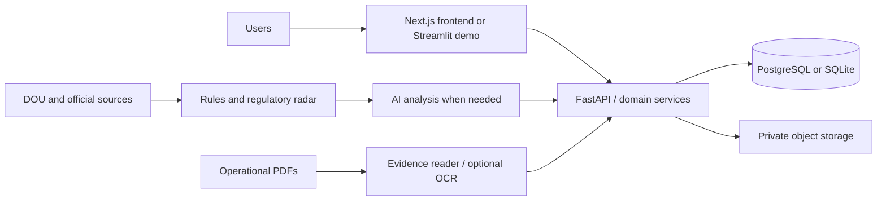

# Mitra — regulatory control tower

Mitra is a regulatory-control platform for operational assets. It brings obligations, deadlines, supporting evidence, regulatory changes, and audit history into one workspace so each responsible person can act on what needs attention. Mining is the first vertical; the underlying asset model also supports healthcare, construction, pressure vessels, environmental licences, and other regulated operations.


## Run locally

### Demo interface

The Streamlit demo is the fastest way to explore the product. It works offline and without an AI key by using the committed demonstration data and cache.

```bash
uv sync
uv run streamlit run app.py
```

Open the address printed by Streamlit. To reset or prepare local demo assets:

```bash
uv run python -m mitra.demo       # rebuild the demo database
uv run python -m mitra.exemplos   # generate fictional evidence PDFs
uv run pytest                     # run backend tests
```

### Product interface, API, and frontend

The production-oriented interface is a Next.js application backed by FastAPI. It requires Node.js 22.12+ in addition to `uv`.

```bash
uv sync
uv run uvicorn api.main:app --reload

cd front
npm ci
npm run dev                       # http://localhost:3000; API at http://localhost:8000
```

For a production-like local build, run `npm run build`; the API then serves `front/out` at `http://localhost:8000`. Run the frontend checks from `front/`:

```bash
npm run lint
npm run typecheck
npm test
npm run e2e
```

### Optional live data and AI

Copy `.env.example` to `.env` and configure a provider key only when live AI analysis is needed. Without a key, the interface remains usable, but actions that require a new model response are unavailable. Official source texts and DOU files are intentionally not committed:

```bash
uv run python -m mitra.fontes                              # download official regulatory texts
uv run python -m collector.xml_dou data/raw/dou/FILE.zip   # process a monthly DOU archive
uv run python -m mitra.impacto data/raw/dou/FILE.zip       # assess regulatory impact
RUN_IA=1 uv run pytest tests/test_ia_real.py -v            # live-model cases
```

## What the project does

Mitra operates through two connected flows:

- **Regulation to action:** the DOU radar identifies relevant new acts, proposes a versioned change, and requires a regulatory decision before it becomes effective.
- **Evidence to compliance:** operational PDFs—such as inspection reports, reports, and certificates—are interpreted as evidence for the appropriate obligation. Rules validate the asset, document type, date, and deadline; OCR can be enabled for scanned files.

The Inbox is the central experience. It consolidates overdue obligations, missing registration data, upcoming deadlines, triggered events, and proposed regulatory changes. From there, users can register a delivery, complete asset data, or make a regulatory decision.

### Main capabilities

- Asset map and operational record, including obligations, applicable legal excerpts, evidence, and registration data.
- Deadline management, filters, bulk delivery registration, comments, assignment, monthly calendar, Excel export, `.ics` calendar, and weekly briefings.
- Regulatory change management with before/after comparison, source excerpt, approval workflow, version history, transition plan, and timeline.
- DOU radar and regulatory-coverage discovery, which identify published rules that may apply to a client portfolio but are not yet in the catalogue.
- Evidence intake for operational documents, including event-triggered obligations such as special safety inspections.
- Client onboarding for assets, licences and conditions, technical responsibles, units, access, internal deadlines, and company-specific rules.
- Import of a mining company from public SIGBM data. Information not available in the source is flagged as missing instead of assumed.
- A read-only MCP agent and the **Ask Mitra** chat, both constrained by the same access scope as the interface.

### Users and access

| Role | Scope |
|---|---|
| IT | Manages accounts, roles, areas, and passwords; does not access regulatory data. |
| Board | Views all assets and assigns their responsible area. |
| Regulatory | Views all assets and approves regulatory changes. |
| Area manager | Views and operates only the assets and obligations assigned to their area. |
| Mitra curation | Manages platform-wide regulatory content; client operational data is read-only. |

Every delivery, decision, assignment, and relevant data change is recorded in the audit history.

### Demo scope

The fictional Serra Azul mining company contains eight assets and a regulatory catalogue for dams, pressure vessels, mining activities, and an environmental licence. The demo also includes a fictional healthcare organisation to demonstrate that the model is not limited to dams. It uses public SIGBM-derived company data without personal identifiers and fictional locations and operational documents.

The featured regulatory scenario shows how a new ANM act changes only the affected obligation and preserves the rest of the catalogue.


## Architecture and AWS

The repository contains both the Streamlit demo and the product application. The product frontend communicates exclusively with the API; FastAPI can serve the static Next.js build in the same origin.



Rules are evaluated before AI, and each model proposal is checked against the source text before becoming a proposed change or evidence. The catalogue keeps the literal legal excerpt, applicability rule, and schedule for every obligation. Missing data remains visible as a task rather than creating a false compliance status.

The AWS CDK stack provisions ECS Fargate behind an ALB, RDS PostgreSQL 16, private versioned S3 storage, Bedrock for model analysis, Textract for scanned PDFs, EventBridge jobs for the DOU radar, Secrets Manager, and CloudWatch alarms. Deployment can use AWS CodeBuild/ECR or GitHub Actions with OIDC. See [infrastructure instructions](infra/README.md) for exact commands and prerequisites.

```bash
uv sync --group infra
uv run --group infra pytest tests/test_infra.py
cd infra && npx aws-cdk@2 synth
```

## Repository guide

| Path | Purpose |
|---|---|
| `front/` | Next.js and TypeScript product interface. |
| `api/` | FastAPI API, sessions, access scope, and audit endpoints. |
| `mitra/` | Regulatory catalogue, rules, schedules, evidence, impact analysis, reports, onboarding, and domain services. |
| `collector/` | Monthly DOU XML reader. |
| `agente/` | Read-only MCP server for external assistants. |
| `cadastro/`, `seed_obligations.csv` | Curated regulatory catalogue. |
| `data/` | Fictional demo data, fixtures, and generated local data. |
| `infra/` | AWS CDK infrastructure and deployment configuration. |

## Quality, sources, and supporting documentation

Automated tests cover regulatory impact isolation, literal-source validation, AI cache and spend limits, access segregation, audit records, document-to-evidence flows, data imports, personal-data protection, API connection handling, Docker contents, frontend behaviour, and infrastructure synthesis.

The catalogue is curated from official sources, including ANM, Brazilian labour regulations, the Chamber of Deputies, and the Minas Gerais Legislative Assembly. The discovery process uses official open-data sources to find uncatalogued relevant rules; curation approval is required before a rule enters the catalogue.

Further details are kept in focused documents:

- [Architecture decisions and measured costs](docs/ARQUITETURA.md)
- [Three-minute demo script](docs/ROTEIRO_DEMO.md)
- [Market analysis](docs/ANALISE_MERCADO.md)
- [Five-minute pitch](docs/PITCH.md)
- [Research and evaluation material](PREP.md)
- [AWS deployment guide](infra/README.md)
