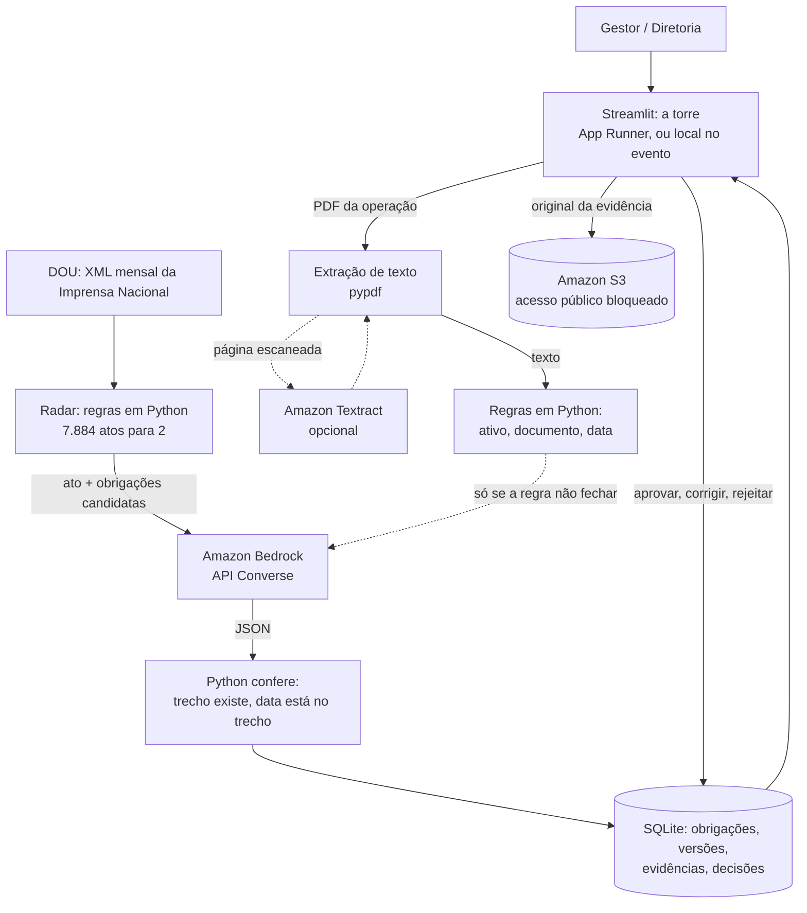

# RegulaIA: torre de controle regulatória para mineração

Hackathon VX, Desafio 02. Rio de Janeiro, 7 e 8 de novembro de 2026.

A torre mostra, para cada ativo de uma mineradora, tudo o que ele precisa cumprir hoje: a obrigação, a norma, o artigo, o trecho literal que a cria, quando vence e se já foi comprovada. Os ativos podem ser:

- barragem;
- vaso de pressão;
- unidade de mineração;
- licença ambiental.

Ela se atualiza por dois caminhos:

- **norma nova:** o radar lê o Diário Oficial, acha o ato que mexe numa obrigação e propõe a mudança, que uma pessoa aprova;
- **documento da operação:** uma FIR, um laudo ou um boletim vira evidência, e a obrigação fica em dia.

Cada gestor vê só os seus ativos e ninguém precisa ler norma nenhuma.


## A demo

A Mineradora Serra Azul é fictícia, mas os perfis das quatro barragens vêm do SIGBM. A empresa tem 8 ativos e 72 obrigações cadastradas, em 7 de novembro de 2026:

| Aba | O que mostra |
|---|---|
| **Hoje** | Status de cada obrigação por ativo (🔴 atrasada, ⚪ dado faltando no cadastro, 🟡 vence em breve, 🟢 em dia, 🔵 por gatilho). Também recebe documentos: o PDF de uma FIR dá baixa na quinzena, e uma anomalia que obriga Inspeção de Segurança Especial dispara o aviso: pontuação 10 pela Res. 95, EC = 5 pela Res. 220. Registrada, a anomalia abre a ISE do ativo, que fica atrasada até chegar o relatório da inspeção. Gera o boletim da semana de cada gestor (PDF ou texto) e um calendário .ics com os vencimentos e um lembrete no dia em que a obrigação fica amarela (só download; nada é enviado) |
| **Transição e linha do tempo** | O que muda quando a Res. ANM 220/2025 substitui a Res. 95/2022 (2/8/2027), por tema: o que continua, o que é novo, o que deixa de valer para aquele ativo (e por quê: "só para DPA2 ≥ 4"), com o plano de transição para baixar em PDF. Mostra também as datas futuras de cada ativo |
| **Mudanças** | Versões propostas por atos novos, com antes/depois, o trecho do ato e a conferência do Python. Só valem depois de aprovadas. Embaixo, o histórico de cada obrigação: todas as versões, a origem e quem decidiu |
| **Radar do DOU** | O funil de um mês do DOU (7.884 atos → 825 da ANM → 2 candidatos → 1 mudança) e o custo real da IA. Embaixo, "Teste com um ato seu": cole qualquer texto e veja a triagem, a análise e a conferência, e mande para aprovação |
| **Mercado** | Barragens e empresas no SIGBM (com fonte), por que agora e uma conta de receita com premissas ajustáveis |
| **Como funciona** | Diagrama dos dois fluxos (norma → torre e documento → torre) com os números da demo e as três garantias: a IA não decide sozinha, regra antes de IA, traga sua chave |

**Caso principal.** A Res. ANM 245/2026 adiou o art. 7 §1 da Res. 220/2025 de 2/8/2027 para 26/12/2029. Esse parágrafo tira as áreas de lavra, beneficiamento e disposição de rejeitos das estruturas associadas à barragem, e quem trabalha nelas deixa de poder ficar na Zona de Autossalvamento (ZAS). Um sistema correto muda essa obrigação e deixa as outras 23 da Res. 220 iguais. A NR-22 (Portaria MTE 105/2026, item 22.24.8) dá a mesma data para barragens não alteadas a montante, também sobre quem pode ficar na ZAS. A linha do tempo mostra as duas normas, ANM e MTE, convergindo.


## O que está cadastrado

| Arquivo | Norma | Obrigações |
|---|---|---|
| [cadastro/res95_2022.csv](cadastro/res95_2022.csv) | Res. ANM 95/2022 (vale até 1/8/2027) | 21 |
| [seed_obligations.csv](seed_obligations.csv) | Res. ANM 220/2025 (vale a partir de 2/8/2027) | 24 |
| [cadastro/nr13.csv](cadastro/nr13.csv) | NR-13, vasos de pressão (Tabela 2, por categoria) | 10 |
| [cadastro/nr22.csv](cadastro/nr22.csv), [nr22_zas.csv](cadastro/nr22_zas.csv) | NR-22, mineração | 11 |
| [cadastro/lo_serra_azul.csv](cadastro/lo_serra_azul.csv) | Licença de operação fictícia e LC 140/2011 | 6 |

Cada obrigação tem três campos que a máquina lê:

- **regra:** a quais ativos se aplica (ex.: `dpa = alto`, `metodo_construtivo != montante e trabalhadores_zas`);
- **agenda:** quando vence (ex.: `quinzenal+15d`, `anos:3`, `unica`);
- **trecho:** o texto literal da norma.

Os 66 trechos das normas oficiais são conferidos por teste (`tests/test_trechos.py`) contra os textos baixados das fontes oficiais (ANMlegis e gov.br/trabalho-e-emprego). A lista das fontes está em `regulaia/fontes.py`. A licença é fictícia e não tem texto para conferir.

O cadastro sai das normas assim: a IA propõe as obrigações a partir do texto (`regulaia/extrator.py`), uma pessoa escolhe e ajusta (`curadoria/*.csv`) e o script gera o CSV final (`regulaia/curadoria.py`). Repetir o processo dá o mesmo resultado.

## O que os testes garantem

| Garantia | Teste |
|---|---|
| A Res. 245 muda só a OB-01, e só na B2; a Res. 246 não muda nada | `tests/test_impacto.py` (e `tests/test_ia_real.py` com o modelo de verdade) |
| A IA não inventa: trecho que não está no ato ou data que não está no trecho é reprovado | `test_trecho_inventado_e_reprovado…`, `test_data_que_nao_esta_no_trecho…`, `test_ia_nao_pode_inventar_data` |
| Ato sem relação com o cadastro não chama a IA; resposta repetida vem do cache, mesmo sem chave | `test_ato_sem_relacao_nao_chama_a_ia`, `test_cache_vale_mesmo_sem_chave` |
| Cada trecho citado no cadastro existe no texto oficial (66 trechos) | `tests/test_trechos.py` |
| Anomalia abre a ISE e ela só fecha com o relatório; na Res. 220 a regra é a do art. 42 | `tests/test_evidencias.py` |
| ANM e MTE vencem juntas na ZAS depois de aprovada a Res. 245; sem aprovação, nada muda | `test_zas_aprovada_vence_junto_com_a_nr22_no_painel` |
| Os números da documentação, do roteiro e da análise de mercado batem com o cadastro, a demo, o DOU e o SIGBM | `tests/test_documentacao.py`, `test_numeros_do_funil_na_tela_e_nos_documentos`, `test_numeros_da_analise_de_mercado_saem_dos_dados` |
| O boletim não contradiz o amarelo da tela; o PDF sai sem emoji quebrado nem marcação crua | `test_boletim_bate_com_o_amarelo_da_torre`, `tests/test_pdf.py` |
| Cada gestor só vê os ativos dele, em todas as abas (texto, tabelas e títulos), e não registra documento de ativo de outro gestor | `test_cada_gestor_so_ve_os_ativos_dele`, `test_gestor_nao_registra_documento_de_ativo_alheio` |
| A imagem Docker leva o que a demo precisa e deixa de fora `.env` e dados brutos | `test_imagem_docker_leva_o_que_a_demo_precisa_e_nada_secreto` |

## Conteúdo

| Caminho | O que é |
|---|---|
| [app.py](app.py) | A interface (Streamlit) |
| `regulaia/` | Banco, versões, regras, agenda, torre, extrator, impacto, leitor de evidência, boletim e plano em PDF |
| `collector/` | Leitor do XML mensal do DOU (dados abertos) |
| [data/serra_azul.json](data/serra_azul.json), [data/historico_serra_azul.json](data/historico_serra_azul.json) | A empresa da demo e o histórico de entregas, com as falhas planejadas |
| `data/exemplos/` | PDFs fictícios para o leitor de evidência |
| [data/mercado_sigbm.json](data/mercado_sigbm.json) | Números de mercado com fonte: barragens, empresas, embargos, dano potencial e concentração no SIGBM (só agregados) |
| [docs/ARQUITETURA.md](docs/ARQUITETURA.md) | Decisões de arquitetura e custos medidos |
| [docs/ROTEIRO_DEMO.md](docs/ROTEIRO_DEMO.md) | Roteiro da demo de 3 minutos, com as falas |
| [docs/ANALISE_MERCADO.md](docs/ANALISE_MERCADO.md) | Análise de mercado e viabilidade (entrega do hackathon): problema, tamanho do mercado, concorrência, diferencial, modelo de negócio, riscos e próximos passos, com fontes; números do SIGBM conferidos por teste |
| [docs/PITCH.md](docs/PITCH.md) | Pitch de 5 minutos sem perguntas, slide a slide (o que vai na tela, a fala e o tempo), com o vídeo da demo no meio; números e contagem de palavras conferidos por teste |
| [PREP.md](PREP.md) | Pesquisa, fontes de dados, critérios de avaliação |

## Como rodar

Requer o [uv](https://docs.astral.sh/uv/). Ele instala o Python 3.13 e as dependências na primeira execução.

```bash
uv sync
uv run pytest
uv run streamlit run app.py                                     # a torre (interface)
uv run python -m regulaia.demo                                  # só monta o banco da demo
uv run python -m regulaia.exemplos                              # gera os PDFs de exemplo
uv run python -m regulaia.pdf docs/ANALISE_MERCADO.md analise_de_mercado.pdf "Análise de mercado"   # a análise em PDF
uv run python -m regulaia.fontes                                # baixa os textos oficiais das normas (data/raw/normas)
uv run python -m collector.xml_dou data/raw/dou/S01082026.zip   # funil do mês
uv run python -m regulaia.impacto data/raw/dou/S01082026.zip    # impacto com IA (precisa de chave no .env)
RUN_IA=1 uv run pytest tests/test_ia_real.py -v                 # casos de ouro com o modelo real
uv run python -m regulaia.extrator ORIGEM NORMA TIPO DESTINO    # norma -> obrigações propostas (IA)
uv run python -m regulaia.curadoria ...                         # escolhas humanas -> cadastro/*.csv
```

Num clone novo, `uv run pytest` passa com alguns testes pulados. Eles precisam de arquivos que ficam fora do Git:
- os textos oficiais das normas: baixe com `uv run python -m regulaia.fontes`;
- o ZIP do DOU de agosto;
- a IA de verdade: `RUN_IA=1`.

Com os textos baixados, sobram 4 pulados: 2 precisam do ZIP do DOU e 2 da IA de verdade.

A interface funciona sem chave e sem internet. As respostas da IA ficam em `data/cache_ia.db`, então a demo repete exatamente igual. Para chamar a IA de verdade, copie `.env.example` para `.env` e preencha ao menos uma chave.

O ZIP mensal vem do [portal de dados abertos da Imprensa Nacional](https://www.in.gov.br/acesso-a-informacao/dados-abertos/base-de-dados) (Seção 1, ano e mês) e fica em `data/raw/dou/`, fora do Git. O coletor não acessa o site do DOU, porque o `robots.txt` de www.in.gov.br proíbe robôs.

## Link público antes da AWS

Dois caminhos para mostrar a demo por link, sem chave de IA (tudo roda do cache):

- **Streamlit Community Cloud** (link fixo, não depende da máquina de ninguém): em share.streamlit.io, entrar com o GitHub, **Create app**, repositório `Samzax/hackathon-vx-d02`, branch `main`, arquivo `app.py`, e em *Advanced settings* escolher Python 3.13. Não preencher *Secrets*: sem chave, ninguém de fora gasta crédito de IA. O app instala pelo `requirements.txt`, gerado do `uv.lock` (um teste avisa se ficar desatualizado).
- **Túnel da sua máquina** (link temporário, some quando o computador desliga): rodar uma cópia do repositório sem `.env` e abrir um túnel do Cloudflare para ela:

```bash
cloudflared tunnel --no-autoupdate --url http://localhost:8502
```

O link `https://….trycloudflare.com` aparece na saída do comando. Quem tiver o link usa o app que roda na sua máquina, então a cópia exposta não pode ter `.env`.

## Rodar na nuvem (AWS)

O `Dockerfile` empacota a torre com as dependências de produção (sem pytest; o reportlab vai junto porque o boletim e o plano saem em PDF):

```bash
docker build -t regulaia .
docker run -p 8501:8501 regulaia
```

Sem chave e sem internet, a demo roda do cache (`data/cache_ia_demo.json`). Para usar a IA de verdade, passe as chaves por variável de ambiente (`--env-file .env` ou os segredos do serviço). O `.env` nunca entra na imagem.

Na AWS, a mesma imagem serve para os três caminhos: App Runner (mais simples: aponta para a imagem no ECR, porta 8501), ECS Fargate ou uma EC2 com Docker. A verificação de saúde está em `/_stcore/health`.

### Arquitetura na AWS



Linhas tracejadas: caminhos opcionais. O que já está no código e o que falta fazer no evento:

| Serviço | No código | No evento |
|---|---|---|
| Amazon Bedrock (Converse) | `ClienteBedrock` em `regulaia/ia.py`, testado com cliente falso; espera 1,1 s entre chamadas (regra: menos de 1 por segundo) | `REGULAIA_BEDROCK=1` e o perfil AWS no `.env`; trocar os IDs `ID_DO_..._NO_BEDROCK` em `regulaia/modelos.toml` pelos do console e subir a linha do Bedrock para o topo da camada |
| Amazon S3 | `regulaia/arquivos.py` guarda o PDF original de cada evidência registrada, com criptografia no servidor | Criar o bucket em us-east-1 com acesso público bloqueado e pôr o nome em `REGULAIA_S3_BUCKET` |
| Amazon Textract | `regulaia/ocr.py`: página sem texto vai para o OCR, uma chamada por página | `REGULAIA_OCR=textract`. Sem isso, a torre avisa que o PDF é escaneado e pede a versão digital |
| App Runner | `Dockerfile` | Construir a imagem, mandar para o ECR e criar o serviço na porta 8501 |
| DynamoDB | Não usamos: os dados são relacionais (versões de obrigação, uma vigente e uma pendente por vez, junções por ativo) e ficam em SQLite | Para produção com várias instâncias, o caminho é Postgres (RDS): o SQL está concentrado em `regulaia/db.py` |

Teste mínimo antes de confiar na conta do evento: uma chamada ao Bedrock, um PDF no S3 e um escaneado no Textract, os três pela torre. Nenhum dado pessoal vai para a conta: a demo usa só a mineradora fictícia e atos públicos do DOU.

> A imagem ainda não foi construída (Docker Desktop desligado nesta máquina). Conferido sem Docker, num diretório limpo: as duas etapas de instalação do Dockerfile (`uv sync --locked --no-dev --no-install-project` e depois `uv sync --locked --no-dev`) passam, as seis abas abrem sem erro só com as dependências de produção, os dois PDFs baixam e o `.env` fica de fora. Um teste confere que tudo o que o app importa está em `[project].dependencies`. Falta conferir o build em Linux, o que leva um minuto com `docker build`.
