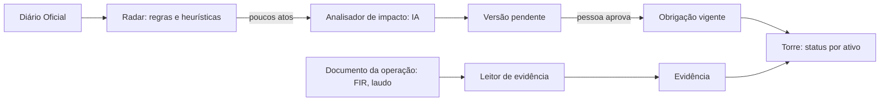

# Arquitetura e decisões

Este documento registra as decisões que já foram tomadas. Ele muda junto com o código.

## O produto em uma frase

Para cada ativo de uma empresa regulada, mostrar o que precisa ser entregue, até quando, por quê (qual artigo) e o que mudou desde ontem. Tudo se atualiza quando sai uma norma nova ou chega um documento da operação.

Mineração é a primeira vertical. O modelo de dados usa "ativo" e não "barragem", para que o mesmo motor atenda obras, equipamentos (QSMS) e licenças ambientais.

## Os dois fluxos



- **De cima para baixo:** norma → obrigações → o que cada ativo precisa fazer.
- **De baixo para cima:** documento da operação → evidência → obrigação cumprida.
- **Na torre:** cada obrigação de cada ativo aparece como 🔴 atrasada, ⚪ dado faltando no cadastro do ativo, 🟡 vence em breve, 🟢 em dia ou 🔵 por gatilho (só vale se acontecer algo: incidente, anomalia, modificação). Uma mudança aguardando aprovação aparece com ⚠️ ao lado.

## A torre: agenda e status

Cada obrigação tem uma `agenda` curta que a máquina lê (`regulaia/agenda.py`):

| Agenda | Exemplo | Uso |
|---|---|---|
| `quinzenal+15d`, `mensal+10d`, `trimestral+30d`, `semestral+30d`, `anual+0d` | FIR quinzenal | Período de calendário mais a folga para entregar |
| `datas:03-31,09-30` | Campanhas da DCE | Datas fixas todo ano |
| `anos:3`, `meses:6` | Exame externo do vaso (NR-13) | Contado da última execução |
| `unica` | Mapa da ZAS até 26/12/2029 | Uma vez, até o `prazo` (que uma norma nova pode mudar) |
| `evento` | ISE depois de anomalia | Sem calendário: depende de gatilho |

O status vem de comparar os períodos vencidos com as evidências recebidas. "Dado faltando" aparece quando a regra de aplicabilidade precisa de um atributo que o cadastro do ativo não tem. Por exemplo, o cadastro da B4 não diz se ela passou por modificação estrutural, então não dá para saber se ela deve uma RPSB nova (Res. 95, R95-08). A torre mostra a dúvida em vez de esconder a obrigação.

O campo `vigencia_desde`/`vigencia_ate` faz a troca de norma sozinha. As 21 obrigações da Res. 95/2022 valem até 1/8/2027 e as 15 da Res. 220/2025 a partir de 2/8/2027. A aba "Transição" agrupa as duas por tema (FIR, RPSB, PAEBM…) para mostrar o que continua, o que é novo e o que acaba.

## Cadastro: da norma ao CSV, com uma pessoa no meio

```
norma (ANMlegis ou PDF) -> unidades (artigos / itens) -> blocos de ~9 mil caracteres
   -> IA propõe obrigações em JSON -> Python confere -> data/extraido/*.json
   -> pessoa escolhe e ajusta (curadoria/*.csv) -> regulaia.curadoria -> cadastro/*.csv
```

- **O Python confere cada proposta da IA.** O trecho citado tem de estar no texto do bloco e o dispositivo citado tem de pertencer ao bloco. A regra de aplicabilidade tem de ser válida e só usar atributos que existem no cadastro daquele tipo de ativo. A proposta que falha fica marcada como reprovada, com o motivo.
- **Repetível.** A curadoria guarda só as escolhas (artigo + parte do título + ajustes). Rodar de novo gera o mesmo CSV a partir da extração versionada.
- **Leitura das normas.** A da ANM vem do ANMlegis (HTML por artigo). A NR vem do PDF, por item (`22.24.8`). O leitor pula o sumário, junta itens repetidos e descarta os revogados.

## Leitor de evidência

Quem opera a barragem manda o PDF (FIR, relatório do vaso, boletim de efluentes) e a torre dá baixa na obrigação certa (`regulaia/evidencias.py`):

1. **Regra.** Acha o ativo (código entre parênteses ou nome inteiro: "Serra I" não casa "Serra II"), o tipo de documento por palavra-chave e a data de execução.
2. **Desempate.** Se mais de um ativo é citado, fica o que tem obrigação vigente daquele tipo de documento. Um boletim de efluentes que cita a licença e a unidade vai para a licença.
3. **IA só se a regra não fechar.** A data que ela indicar tem de estar escrita no documento; se não estiver, a leitura fica com um problema e não é registrada.
4. **Período.** A data vira o período que a evidência comprova (`2026-10-1Q`, `2026-09`, a própria data para `anos:N`).
5. **Gatilhos.** Uma FIR com pontuação 10 avisa que a Inspeção de Segurança Especial é obrigatória e que o registro no SIGBM tem prazo de 24 horas.
6. **Entrega fora do prazo.** O período comprovado é sempre o da execução (a inspeção). Se o documento traz a data de envio (o recibo do EIR, por exemplo) e ela passou do prazo, a leitura avisa sem bloquear, e o aviso fica gravado na evidência.

Documentos de exemplo, todos fictícios, em `data/exemplos/`. São gerados de forma determinística por `uv run python -m regulaia.exemplos`:

- FIR comum e FIR com anomalia;
- recibo do EIR;
- relatório de exame externo de vaso (NR-13);
- boletim de efluentes.

PDF sem texto (escaneado) volta com um aviso claro. O OCR fica para depois.

## Saídas para quem não abre a torre

O gestor não precisa entrar no sistema para saber o que fazer:

- **Boletim da semana** (`torre.boletim`, Markdown): só os ativos daquele gestor, com atrasadas, vencendo em 30 dias, dado faltando e mudanças aguardando aprovação. Cada item traz norma e dispositivo.
- **Calendário** (`torre.calendario`, .ics, RFC 5545): um evento por vencimento e por obrigação que começa a valer. Os UIDs são estáveis, então reimportar atualiza os eventos em vez de duplicar.

Os dois são só gerados para download. Mandar por e-mail fica para a versão com servidor.

**Rastreabilidade.** `db.historico` devolve todas as versões de uma obrigação, com o ato, o trecho e quem decidiu. A aba "Mudanças" mostra isso para responder "por que este prazo é este?".

## O que a demo mostrou sobre as normas

**A ANM e o MTE dão a mesma data para a ZAS.** A Res. ANM 245/2026 adiou o mapa de inundação com a Zona de Autossalvamento para 26/12/2029. A NR-22 (item 22.24.8, Portaria MTE 105/2026) dá a mesma data para barragens não alteadas a montante; para as alteadas a montante, a exigência é imediata. Uma barragem passa a ter duas obrigações, de dois reguladores, com o mesmo prazo. A linha do tempo mostra isso sem ninguém ler as duas normas.

## Banco de dados: SQLite

| Critério | SQLite agora | Produção |
|---|---|---|
| Velocidade | Arquivo local, consultas em milissegundos | Postgres (RDS) |
| Agilidade | Zero infraestrutura, roda igual em toda máquina | |
| Custo | Zero | |

Todo acesso passa por `regulaia/db.py`. Trocar de banco mexe só nesse arquivo.

Ficou de fora o DynamoDB, que o primeiro rascunho sugeria. Os dados são relacionais (empresa → ativo → obrigação → versão → evidência → ato), e o DynamoDB complica esse tipo de consulta.

**Obrigações nunca são sobrescritas.** Cada mudança cria uma versão nova, ligada ao ato que a causou e ao trecho citado. Ela fica `pendente` até uma pessoa aprovar. Isso dá a comparação antes/depois, a resposta para "por que esse prazo é esse?" e o histórico de quem decidiu.

O cadastro inicial está em `seed_obligations.csv`, legível e revisável no GitHub. A coluna `regra` diz a quais ativos cada obrigação se aplica (a sintaxe está em `regulaia/regras.py`).

## Custo da IA: cada camada só passa adiante o que não conseguiu resolver

| Camada | O que faz | Custo |
|---|---|---|
| 0. Regras | Órgão, tipo de ato, regex de "art. X da Resolução Y", datas | Zero |
| 1. Busca por contexto | Acha quais obrigações o ato provavelmente toca (busca local por palavras e números de artigo) | Zero |
| 2. Modelo barato | Extrai a mudança em JSON, com o trecho citado | Centavos |
| 3. Modelo forte | Só quando o barato devolve baixa confiança ou o Python reprova a resposta | Raro |

Mais duas proteções:
- **Cache por conteúdo.** A tabela `analise_ia` guarda cada resposta pela chave sha256(tarefa + modelo + prompt + entrada). O mesmo ato nunca é pago duas vezes, e o custo total fica medido.
- **A IA nunca decide sozinha.** O Python confere se o trecho citado existe no ato e se o artigo bate com a obrigação, e uma pessoa aprova a mudança.

### Custos medidos (DeepSeek V4.1 Flash via OpenCode Go)

| Tarefa | Quanto | Custo |
|---|---|---|
| Extrair obrigações da Res. ANM 95/2022 (norma inteira) | 1 vez por norma | US$ 0,065 |
| Extrair obrigações da NR-13 | 1 vez por norma | US$ 0,045 |
| Extrair obrigações da NR-22 (capítulo de barragens) | 1 vez por norma | US$ 0,009 |
| Analisar o impacto de um ato candidato do DOU | ~2 mil tokens de entrada | US$ 0,0005 a 0,002 |
| Funil de um mês do DOU (7.884 atos) | 825 da ANM → 2 candidatos para a IA | menos de US$ 0,01 |

As regras resolvem 99,97% do volume. A IA só vê o que sobrou, e cada resposta fica em cache.

**A demo roda sem chave e sem internet.** As respostas de IA da demo (análises de impacto e extração das normas) estão em `data/cache_ia_demo.json`, no Git, com o custo original de cada chamada. Num clone novo, `demo.preparar` carrega esse arquivo no cache local antes de rodar o radar. Sem ele, a aba "Mudanças" ficaria vazia e não daria erro (há teste para isso). Para atualizar o arquivo: `uv run python -m regulaia.demo --exportar-cache`.

## Provedores de IA: troca por configuração

O código fala com uma interface única. Qual provedor e qual modelo atende cada tarefa fica num arquivo de configuração, e as chaves ficam no `.env`, nunca no GitHub.

| Camada | Padrão | Se não houver |
|---|---|---|
| 2. Modelo barato | DeepSeek V4.1 Flash via OpenCode Go (franquia do plano de US$ 10) | Claude Haiku (OpenCode Go ou Anthropic) |
| 3. Modelo forte | DeepSeek V4.1 Flash com raciocínio no máximo (`max`, mesma franquia) | Claude Sonnet, se houver chave da Anthropic ou Bedrock. Opus não: caro demais para o ganho |
| No evento | Claude 5 no Bedrock (a família 5.5 não estaria disponível lá) | O mesmo de antes, pela internet |

A OpenCode Go mistura dois formatos de API: alguns modelos usam o da OpenAI (`/chat/completions`, ex.: DeepSeek) e outros o da Anthropic (`/messages`, ex.: Haiku, Qwen). O código fala os dois, o que também cobre a Anthropic e a DeepSeek diretas. O Bedrock entra por um adaptador próprio (Converse).

**Conta do cliente (traga sua chave).** O provedor e a chave são configuração, não código. Uma empresa pode rodar a RegulaIA com a própria conta (Bedrock na AWS dela, Anthropic, DeepSeek), e os documentos dela não passam pela nossa conta. Para mineradoras, isso responde à pergunta "para onde vão meus dados?".

Os prompts não podem depender de um modelo específico. A saída é sempre JSON validado pelo Python, então trocar de modelo muda o custo e a qualidade, não o funcionamento.

Sobre o `AGENTS.md`: ele é uma convenção para agentes de programação (Codex, OpenCode, Claude Code) e não é lido por chamadas de API. O equivalente no nosso produto é o arquivo de configuração: ele manda a camada 2 usar um modelo barato (Haiku, DeepSeek) e só a camada 3 usar um forte (Sonnet).

## Fontes de dados

- O `robots.txt` de www.in.gov.br proíbe robôs. O radar usa os canais oficiais de acesso em lote: o XML mensal de dados abertos e o INLABS.
- A demo não depende de internet: os dados são processados antes e ficam em cache.
