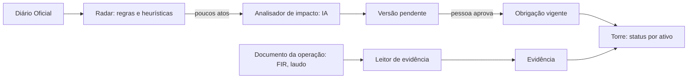

# Arquitetura e decisões

Este documento registra as decisões que já foram tomadas. Ele muda junto com o código.

## O produto em uma frase

Para cada ativo de uma empresa regulada, mostrar o que precisa ser entregue, até quando, por quê (qual artigo) e o que mudou desde ontem. Tudo se atualiza quando sai uma norma nova ou chega um documento da operação.

Mineração é a primeira vertical. O modelo de dados usa "ativo" e não "barragem", para que o mesmo motor atenda obras, equipamentos (QSMS) e licenças ambientais.

## Os dois fluxos



- **De cima para baixo:** norma → obrigações → o que cada ativo precisa fazer.
- **De baixo para cima:** documento da operação → evidência → obrigação cumprida.
- **Quem aprova pode corrigir.** Se a IA propôs um valor errado (ex.: leu 31/12 na notícia em vez de 26/12 no ato), quem aprova corrige o campo antes de aprovar. Vale o valor corrigido, e o histórico guarda o que foi proposto, o que foi aprovado e quem decidiu. A correção passa pelas mesmas conferências da proposta (data AAAA-MM-DD, regra e agenda válidas) e não pode desfazer a mudança inteira: nesse caso é rejeitar.
- **Na torre:** cada obrigação de cada ativo aparece como 🔴 atrasada, ⚪ dado faltando no cadastro do ativo, 🟡 vence em breve, 🟢 em dia ou 🔵 por gatilho (só vale se acontecer algo: incidente, anomalia, modificação). Uma mudança aguardando aprovação aparece com ⚠️ ao lado.

## A torre: agenda e status

Cada obrigação tem uma `agenda` curta que a máquina lê (`regulaia/agenda.py`):

| Agenda | Exemplo | Uso |
|---|---|---|
| `semanal+3d`, `quinzenal+15d`, `mensal+10d`, `trimestral+30d`, `semestral+30d`, `anual+0d` | FIR quinzenal | Período de calendário mais a folga para entregar. Quando uma norma muda a periodicidade em texto ("Semanal"), a agenda acompanha por regra e mantém a folga |
| `datas:03-31,09-30` | Campanhas da DCE | Datas fixas todo ano |
| `anos:3`, `meses:6` | Exame externo do vaso (NR-13) | Contado da última execução |
| `unica` | Mapa da ZAS até 26/12/2029 | Uma vez, até o `prazo` (que uma norma nova pode mudar) |
| `evento` | ISE depois de anomalia | Sem calendário: depende de gatilho |

O status vem de comparar os períodos vencidos com as evidências recebidas. "Dado faltando" aparece quando a regra de aplicabilidade precisa de um atributo que o cadastro do ativo não tem. Por exemplo, o cadastro da B4 não diz se ela passou por modificação estrutural, então não dá para saber se ela deve uma RPSB nova (Res. 95, R95-08). A torre mostra a dúvida em vez de esconder a obrigação.

O campo `vigencia_desde`/`vigencia_ate` faz a troca de norma sozinha. As 21 obrigações da Res. 95/2022 valem até 1/8/2027 e as 24 da Res. 220/2025 a partir de 2/8/2027. A aba "Transição" agrupa as duas por tema (FIR, RPSB, PAEBM…) para mostrar o que continua, o que é novo e o que acaba.

**A contagem não zera na troca de norma.** A RPSB da Res. 220 tem código novo e ainda não tem evidência própria. A torre usa a última RPSB feita pela Res. 95 no mesmo ativo, já que o tema é o mesmo, e diz isso na nota. Isso vale para toda obrigação contada da última execução (`anos:N`, `meses:N`). Assim que chega uma evidência própria, ela passa a valer.

**Tempo de resposta.** Com 8 ativos e 72 obrigações (a medição é de antes das leis federal e mineira), cada clique recalcula todas as abas em 0,3 a 0,4 s (medido com `AppTest`). Os ativos são lidos com uma consulta por ativo, não uma por obrigação. Os metadados das obrigações vêm de uma consulta só, e cada regra é lida uma vez e guardada em cache.

## Cadastro: da norma ao CSV, com uma pessoa no meio

```
norma (ANMlegis ou PDF) -> unidades (artigos / itens) -> blocos de ~9 mil caracteres
   -> IA propõe obrigações em JSON -> Python confere -> data/extraido/*.json
   -> pessoa escolhe e ajusta (curadoria/*.csv) -> regulaia.curadoria -> cadastro/*.csv
```

- **O Python confere cada proposta da IA.** O trecho citado tem de estar no texto do bloco e o dispositivo citado tem de pertencer ao bloco. A regra de aplicabilidade tem de ser válida e só usar atributos que existem no cadastro daquele tipo de ativo. A proposta que falha fica marcada como reprovada, com o motivo.
- **Repetível.** A curadoria guarda só as escolhas (artigo + parte do título + ajustes). Rodar de novo gera o mesmo CSV a partir da extração versionada.
- **Leitura das normas.** A da ANM vem do ANMlegis (HTML por artigo). A NR vem do PDF, por item (`22.24.8`). O leitor pula o sumário, junta itens repetidos e descarta os revogados.

## Descoberta: quais normas a carteira precisa e o catálogo ainda não tem

O extrator transforma uma norma em obrigações; o radar do DOU pega a norma nova. Faltava saber quais normas
já publicadas valem para os ativos das clientes. O catálogo não pode depender de alguém lembrar da lei do
Pará quando entrar uma cliente com barragem no Pará.

```
ativos das clientes -> perfil (jurisdição x tipo de ativo: barragem em MG, unidade no Brasil...)
   -> fontes oficiais, ano a ano (Senado, ANMlegis, Assembleia de Minas) -> camada 0, sem IA:
      termos do tipo de ativo (temas.toml), revogada fora, regra fora (crédito, homenagem, concessão
      de lavra a uma empresa), e a norma que regulamenta ou altera uma candidata ou uma do catálogo
   -> triagem pela IA, pela ementa: cobra algo de quem opera o ativo? de qual tipo?
   -> curadoria RegulaIA aprova ou descarta, com nome e nota -> extrator -> curadoria -> catálogo
   -> cobertura por cliente: o que está no catálogo, o que espera, até quando cada fonte foi lida
```

- **Fontes com dados abertos, nada de robô contra verificação.** O Senado tem API de legislação federal
  (lista por tipo e ano); a Assembleia de Minas publica toda a legislação mineira em CSV por ano, com a
  situação de vigência; o ANMlegis lista as resoluções da ANM por ano, com a revogada marcada. O LexML,
  que indexa todos os estados, responde com uma verificação anti-robô: não é usado. Estado sem conector
  aparece na cobertura como "sem fonte automática: cobertura não verificada", nunca como coberto.
- **A segunda passada pega o que a palavra-chave perde.** A ementa do Decreto 9.406/2018 ("Regulamenta o
  Decreto-Lei nº 227...") não tem palavra de mineração; entra porque cita o Código de Mineração, que já é
  candidato. A passada repete até não aparecer mais nenhuma.
- **Descarte duvidoso relê pelo texto.** A triagem é pela ementa, e ementa engana: "Institui a Política
  Estadual dos Atingidos por Barragens" parece só organização do Estado, e a IA descartou a Lei MG
  23.795/2021. Descarte com confiança abaixo de 0,85 baixa o texto oficial (do artigo 1º em diante) e
  pergunta de novo, pedindo o artigo que cobra o empreendedor. A lei federal vem do texto atualizado da
  Câmara (o Planalto bloqueia robô); onde não há texto, fica a decisão pela ementa e a curadoria pode reabrir.
- **Vigência e alterações das federais** (`regulaia/vigencia.py`). O Senado não diz na listagem se a norma
  está em vigor. O resolvedor de URN do LexML (liberado no robots.txt, 5 s entre pedidos; a busca do LexML
  tem desafio anti-robô e não é usada) leva à ficha da norma na Câmara: situação, quem alterou ou revogou
  e em quais artigos, e o texto consolidado. Quando a Câmara não tem a ficha (decretos recentes), vale o
  detalhe da norma nos dados abertos do Senado (situação "R" e as normas posteriores); quando nem o LexML
  liga a norma, vale o endereço do Senado que a própria candidata trouxe da descoberta. Na fila real, as
  248 candidatas federais foram lidas (229 pela Câmara, 19 pelo Senado) e 140 estavam revogadas (18 delas a IA tinha marcado relevante):
  saem como descartadas, com a norma revogadora e o link na nota. Aprovada e revogada fica para a curadoria.
- **O catálogo é conferido contra o texto de hoje.** `vigencia catalogo` lista as alterações de cada norma
  federal do catálogo com as obrigações que citam os artigos alterados, e confere cada trecho citado no
  texto atualizado: os 23 da Lei 12.334 continuam lá depois da Lei 15.355/2026 (que mudou os art. 3º e 15,
  fora do catálogo). Trecho que sumiu do texto vai para a curadoria.
- **Na dúvida, a IA marca relevante com confiança baixa.** O que ela descarta não chega a ninguém; o que
  ela marca, a curadoria lê. A curadoria também pode reabrir uma descartada.
- **Quem altera norma do catálogo vem marcado.** Uma resolução que altera a Res. 95 pode já estar no texto
  consolidado que o catálogo usa: a fila diz "cita Res. ANM 95/2022: conferir o texto consolidado".
- **Lacunas conhecidas ficam escritas** (`temas.toml`): Normas Regulamentadoras (sem lista em dados
  abertos), Conama, Ibama e ANA, e em Minas as deliberações do Copam e as resoluções da Semad e da Feam.
- **É trabalho da plataforma.** A fila e as decisões ficam fora do "Recriar demo", como as contas; a
  cliente vê a própria cobertura, não a fila.
- **Na API, leitura e decisão; busca e triagem são job.** `GET /empresas/{id}/cobertura` (cliente só a dela,
  gestor só as linhas dos ativos da área), `GET /normas-candidatas` e `GET /normas-candidatas/{chave}` (só a
  plataforma: a cliente recebe 403), `POST /normas-candidatas/{chave}/decisao` (só a curadoria, com o e-mail
  da sessão e a auditoria `descoberta.decidir`). Buscar e triar leem dezenas de milhares de normas e chamam a
  IA: `python -m api.jobs descoberta`, que sai com erro se uma fonte falhou ou a triagem parou.
- **Aprovada não é coberta.** A cobertura separa "esperando curadoria" de "aprovada, falta extrair": só
  quando a norma vira obrigação no catálogo a linha pode ficar verde.

## Leitor de evidência

Quem opera manda o PDF e a torre dá baixa na obrigação certa (`regulaia/evidencias.py`). São 23 tipos de documento:
- barragem: FIR, EIR, RISR, DCE, RPSB, DCO, RCO, ISE, RCIE e recibo do EIE, simulado, treinamento e seminário do PAEBM, PGRBM;
- vaso NR-13: exame externo e interno;
- mina: treinamento da brigada e simulação de emergência da NR-22;
- licença: efluentes, águas, ruído, PRAD e relatório de condicionantes.

Ficam de fora só as obrigações únicas comprovadas por plano ou requerimento, como a adequação da ZAS e a renovação da licença.

1. **Regra.** Acha o ativo, o tipo de documento e a data de execução.
   - **Ativo.** Vale primeiro o código explícito: entre parênteses ("(B3)") ou depois de um rótulo ("Barragem B3", "Ativo: B3"). Um "B3" solto no texto não vale. Sem código, vale o nome inteiro, com ou sem o tipo ("Córrego Fundo"), ou a tag do vaso ("VP-101"). "Serra I" não casa "Serra II". Código que não está no cadastro vira um problema que diz qual código o documento citou.
   - **Tipo.** É o nome que aparece primeiro, o título: um RCO cita a DCO no corpo.
   - **Data.** Vale a data com rótulo ("Data da inspeção", "realizada em"), em `03/11/2026`, `03.11.2026`, `03-11-2026` ou "3 de novembro de 2026". Sem rótulo, só se houver uma data no texto. Ano com dois dígitos e data impossível não são adivinhados.
2. **Desempate.** Se mais de um ativo é citado, fica o que tem obrigação vigente daquele tipo de documento. Um boletim de efluentes que cita a licença e a unidade vai para a licença.
3. **IA só se a regra não fechar.** A data que ela indicar tem de estar escrita no documento; se não estiver, a leitura fica com um problema e não é registrada.
4. **Período.** A data vira o período que a evidência comprova (`2026-10-1Q`, `2026-09`, a própria data para `anos:N`).
5. **Gatilhos.** A regra da Inspeção de Segurança Especial é a da norma que vale no dia para aquela barragem. Pela Res. 95 (art. 27), anomalia com pontuação 10. Pela Res. 220 (art. 42), anomalia com EC1, EC3, EC4 ou EC5 = 5 no Quadro I.8 (lido como "EC3 = 5", "EC 3: 5", "EC-3 = 5" ou "EC3 (5)", porque ler a menos seria perder uma ISE); EC2 = 5 sozinho não obriga ISE. Nos dois casos o alerta lembra o registro no SIGBM em 24 horas. Uma FIR lida depois da troca sem as colunas EC ganha um aviso (art. 38 §2).
   Registrar a FIR com anomalia **abre** a obrigação de ISE daquele ativo (tabela `acionamento`). A obrigação tem prazo de 24 horas. Ela fica na torre, e depois no boletim, como atrasada até o relatório da ISE ser registrado, que a encerra. Sem isso, o alerta sumiria da tela junto com o documento. Pela Res. 220, EC = 5 abre duas obrigações: o registro no SIGBM em 24 h (art. 38 §4, encerrado pelo recibo do EIE) e a ISE (art. 42, encerrada pelo relatório).
6. **Entrega fora do prazo.** O período comprovado é sempre o da execução (a inspeção). Se o documento traz a data de envio (o recibo do EIR, por exemplo) e ela passou do prazo, a leitura avisa sem bloquear, e o aviso fica gravado na evidência.

Documentos de exemplo, todos fictícios, em `data/exemplos/`. São gerados de forma determinística por `uv run python -m regulaia.exemplos`:

| Arquivo | O que mostra |
|---|---|
| `FIR_B3_2026-10-1Q.pdf` | FIR atrasada da B3: dá baixa na quinzena |
| `EIR_B3_2026-10-1Q_recibo_SIGBM.pdf` | Recibo do EIR enviado 7 dias depois do prazo: comprova, mas avisa o atraso |
| `FIR_B2_2026-11-1Q_anomalia.pdf` | Anomalia com pontuação 10 (Res. 95): abre a ISE da B2 com prazo de 24 h |
| `Relatorio_ISE_B2_2026-11-06.pdf` | Relatório da ISE: encerra a obrigação aberta pela anomalia |
| `FIR_B2_2027-08-1Q_Res220_EC3.pdf` | FIR no modelo da Res. 220 com EC3 = 5: abre o registro no SIGBM e a ISE |
| `EIE_B2_2027-08-02_recibo_SIGBM.pdf` | Recibo do EIE: encerra o registro no SIGBM, a ISE continua aberta |
| `Relatorio_NR13_VP-101_exame_externo.pdf` | Exame externo do vaso E1 (NR-13) |
| `Boletim_efluentes_2026-09.pdf` | Efluentes de setembro: cita a licença e a unidade, vai para a licença |
| `FIR_B3_2026-10-1Q_escaneada.pdf` | A mesma FIR da B3, escaneada (página é imagem, sem texto): mostra o caminho do OCR |

PDF escaneado: a página sem texto vai para o OCR, se estiver ligado (`REGULAIA_OCR=textract`, Amazon Textract, uma chamada por página, ver `regulaia/ocr.py`). O texto do OCR passa pelas mesmas regras e a torre avisa para conferir antes de registrar. Sem OCR ligado, a torre diz que o PDF é escaneado e pede a versão digital; não tenta adivinhar.

## Saídas para quem não abre a torre

O gestor não precisa entrar no sistema para saber o que fazer:

- **Boletim da semana** (`torre.boletim`, Markdown): só os ativos daquele gestor, com atrasadas, vencendo em 30 dias, dado faltando e mudanças aguardando aprovação. Cada item traz norma e dispositivo.
- **Calendário** (`torre.calendario`, .ics, RFC 5545): um evento por vencimento e por obrigação que começa a valer. Os UIDs são estáveis, então reimportar atualiza os eventos em vez de duplicar.

Os dois são só gerados para download. Mandar por e-mail fica para a versão com servidor.

**Rastreabilidade.** `db.historico` devolve todas as versões de uma obrigação, com o ato, o trecho e quem decidiu. A aba "Mudanças" mostra isso para responder "por que este prazo é este?".

## O que a demo mostrou sobre as normas

**A ANM e o MTE dão a mesma data para a ZAS.** A Res. ANM 245/2026 adiou para 26/12/2029 o art. 7 §1 da Res. 220: as áreas de lavra, beneficiamento e disposição de rejeitos deixam de contar como estruturas da barragem, e quem trabalha nelas não pode mais ficar na Zona de Autossalvamento. A NR-22 (item 22.24.8, Portaria MTE 105/2026) dá a mesma data para barragens não alteadas a montante; para as alteadas a montante, a exigência é imediata. Uma barragem passa a ter duas obrigações sobre o mesmo assunto (quem pode ficar na ZAS), de dois reguladores, com o mesmo prazo. A linha do tempo mostra isso sem ninguém ler as duas normas.

**A lei federal já restringe a ZAS desde 2020.** O art. 18-A §2º da Lei 12.334/2010 (incluído pela Lei 14.066/2020) só admite na ZAS os trabalhadores estritamente necessários à operação e à manutenção da barragem, sem data futura. A NR-22 fixa 26/12/2029 para barragens não alteadas a montante, mas sobre uma lista própria de atividades. Na B2, que tem trabalhadores na ZAS, a obrigação da lei já aparece hoje na torre; as da Res. 220 e da NR-22 aparecem na linha do tempo, com as datas futuras. Quem lesse só a NR-22 acharia que tem até 2029.

**Minas cobra mais que a União.** A Lei MG 23.291/2019 exige auditoria técnica de segurança por equipe independente credenciada todo ano para barragem de alto potencial de dano ambiental, com relatório e DCE até 1º de setembro (art. 17), e põe o relatório e o PAE para ciência e assinatura do conselho de administração (art. 18). A classificação estadual não está no SIGBM: numa mineradora importada de MG, ela aparece como dado faltando, e a auditoria não é presumida.

## Banco de dados: SQLite

| Critério | SQLite agora | Produção |
|---|---|---|
| Velocidade | Arquivo local, consultas em milissegundos | Postgres (RDS) |
| Agilidade | Zero infraestrutura, roda igual em toda máquina | |
| Custo | Zero | |

Todo acesso passa por `regulaia/db.py`. Trocar de banco mexe só nesse arquivo.

Ficou de fora o DynamoDB, que o primeiro rascunho sugeria. Os dados são relacionais (empresa → ativo → obrigação → versão → evidência → ato), e o DynamoDB complica esse tipo de consulta.

**Obrigações nunca são sobrescritas.** Cada mudança cria uma versão nova, ligada ao ato que a causou e ao trecho citado. Ela fica `pendente` até uma pessoa aprovar. Isso dá a comparação antes/depois, a resposta para "por que esse prazo é esse?" e o histórico de quem decidiu.

O cadastro inicial está em `seed_obligations.csv`, legível e revisável no GitHub. A coluna `regra` diz a quais ativos cada obrigação se aplica, com `e` e `ou` ("dpa = alto ou dpa2 >= 4", art. 20 §3). A sintaxe está em `regulaia/regras.py`. Um atributo que falta no ativo só aparece como "dado faltando" quando a decisão depende dele.

### O cadastro da Res. 220 conferido contra o texto oficial

Cada uma das 24 obrigações traz na coluna `trecho` o parágrafo da Res. 220 que a cria, copiado do texto consolidado do ANMlegis. Um teste confere que cada trecho existe, palavra por palavra, no texto baixado.

A conferência achou três coisas:
- **O "≥" do ANMlegis é um ">" sublinhado** (`<u>&gt;</u>`). Extrair só o texto perde o sublinhado, e "DPA2 ≥ 4" vira "DPA2 > 4". A barragem B1 tem DPA2 = 4 exatamente, então o erro tiraria dela os treinamentos semestrais, o seminário e a DCO. O leitor de normas agora converte o sublinhado de volta para ≥ e ≤.
- **Faltavam nove obrigações.** O plano de transição mostrava cada uma como "sem equivalente na norma nova":
  - OB-16, art. 54 §2: exercício simulado prático anual para DPA2 ≥ 4.
  - OB-17, art. 56 §1: seminário a pedido da prefeitura para DPA2 < 4.
  - OB-18, art. 38 §4: anomalia EC = 5 no SIGBM em 24 h.
  - OB-19, art. 42: ISE.
  - OB-20, art. 20 §2: monitoramento automatizado.
  - OB-21, art. 20 §3: vídeo 24 h, para "DPA alto ou DPA2 ≥ 4"; foi preciso o `ou` nas regras.
  - OB-22, art. 49: sirenes.
  - OB-23, art. 59: PGRBM a cada 2 anos.
  - OB-24, art. 46 §4: cópias do PAEBM para a defesa civil.

  Com elas, o plano de transição só aponta o que de fato deixa de valer. Na B3 (DPA2 = 2), os treinamentos semestrais e as sirenes saem. O plano diz o motivo: a Res. 220 só os cobra de DPA2 ≥ 4.
- **A regra da ISE mudou de escala.** Pela Res. 95 é pontuação 10; pela Res. 220, coluna EC = 5. O leitor de evidências segue a norma do dia.

## Custo da IA: cada camada só passa adiante o que não conseguiu resolver

| Camada | O que faz | Custo |
|---|---|---|
| 0. Regras | Órgão, tipo de ato, regex de "art. X da Resolução Y", datas | Zero |
| 1. Busca por contexto | Acha quais obrigações o ato provavelmente toca (busca local por palavras e números de artigo) | Zero |
| 2. Modelo barato | Extrai a mudança em JSON, com o trecho citado | Centavos |
| 3. Modelo forte | Só quando o barato devolve baixa confiança ou o Python reprova a resposta | Raro |

Mais duas proteções:
- **Cache por conteúdo.** A tabela `analise_ia` guarda cada resposta pela chave sha256(tarefa + modelo + prompt + entrada). O mesmo ato nunca é pago duas vezes, e o custo total fica medido.
- **A IA nunca decide sozinha.** O Python confere se o trecho citado existe no ato e se o artigo bate com a obrigação, e uma pessoa aprova a mudança.

### Custos medidos (DeepSeek V4.1 Flash via OpenCode Go)

| Tarefa | Quanto | Custo |
|---|---|---|
| Extrair obrigações da Res. ANM 95/2022 (norma inteira) | 1 vez por norma | US$ 0,065 |
| Extrair obrigações da NR-13 | 1 vez por norma | US$ 0,045 |
| Extrair obrigações da NR-22 (capítulo de barragens) | 1 vez por norma | US$ 0,009 |
| Analisar o impacto de um ato candidato do DOU | ~2 mil tokens de entrada | US$ 0,0005 a 0,003 |
| Funil de um mês do DOU (7.884 atos) | 825 da ANM → 2 candidatos para a IA | menos de US$ 0,01 |

As regras resolvem 99,97% do volume. A IA só vê o que sobrou, e cada resposta fica em cache.

**A demo roda sem chave e sem internet.** As respostas de IA da demo (análises de impacto e extração das normas) estão em `data/cache_ia_demo.json`, no Git, com o custo original de cada chamada. Num clone novo, `demo.preparar` carrega esse arquivo no cache local antes de rodar o radar. Sem ele, a aba "Mudanças" ficaria vazia e não daria erro (há teste para isso). Para atualizar o arquivo: `uv run python -m regulaia.demo --exportar-cache`.

## Provedores de IA: troca por configuração

O código fala com uma interface única. Qual provedor e qual modelo atende cada tarefa fica num arquivo de configuração, e as chaves ficam no `.env`, nunca no GitHub.

| Camada | Padrão | Se não houver |
|---|---|---|
| 2. Modelo barato | DeepSeek V4.1 Flash via OpenCode Go (franquia do plano de US$ 10) | Claude Haiku (OpenCode Go ou Anthropic) |
| 3. Modelo forte | DeepSeek V4.1 Flash com raciocínio no máximo (`max`, mesma franquia) | Claude Sonnet, se houver chave da Anthropic ou Bedrock. Opus não: caro demais para o ganho |
| No evento | Claude 5 no Bedrock (a família 5.5 não estaria disponível lá) | O mesmo de antes, pela internet |

A OpenCode Go mistura dois formatos de API: alguns modelos usam o da OpenAI (`/chat/completions`, ex.: DeepSeek) e outros o da Anthropic (`/messages`, ex.: Haiku, Qwen). O código fala os dois, o que também cobre a Anthropic e a DeepSeek diretas. O Bedrock entra por um adaptador próprio, a API Converse do boto3 (`ClienteBedrock`), que serve para Claude, DeepSeek e Nova do mesmo jeito. Ele está testado com um cliente falso; a primeira chamada de verdade é no evento, com a conta da organização (ver "Arquitetura na AWS" no README).

**Conta do cliente (traga sua chave).** O provedor e a chave são configuração, não código. Uma empresa pode rodar a RegulaIA com a própria conta (Bedrock na AWS dela, Anthropic, DeepSeek), e os documentos dela não passam pela nossa conta. Para mineradoras, isso responde à pergunta "para onde vão meus dados?".

Os prompts não podem depender de um modelo específico. A saída é sempre JSON validado pelo Python, então trocar de modelo muda o custo e a qualidade, não o funcionamento.

Sobre o `AGENTS.md`: ele é uma convenção para agentes de programação (Codex, OpenCode, Claude Code) e não é lido por chamadas de API. O equivalente no nosso produto é o arquivo de configuração: ele manda a camada 2 usar um modelo barato (Haiku, DeepSeek) e só a camada 3 usar um forte (Sonnet).

## Pergunte à torre: o chat que só fala do que a torre tem

O chat é um laço de uso de ferramentas (`regulaia/pergunta.py`): o modelo pede consultas, o Python as executa e devolve o resultado, até o modelo responder. As decisões:

- **As ferramentas são as do agente MCP** (`agente/ferramentas.py`), sem depender do pacote `mcp`. Um só lugar define o que o Claude pode consultar, no Claude Desktop e no front. A análise de ato fica de fora do chat: ela chama outra IA.
- **As ferramentas passam pela API, não pelo banco.** A rota chama a própria API em processo, com o cookie ou o token de quem pergunta. Assim, escopo da área, papel e empresa valem igual à tela, sem uma segunda implementação das regras de acesso. Durante o laço, a rota não segura conexão do pool: cada consulta pega e devolve a sua.
- **Conferência pelo Python, não pela palavra do modelo.** Trecho entre aspas (a partir de 25 caracteres), data (AAAA-MM-DD e DD/MM/AAAA) e código (OB-01, R95-08, B3, LO-02) precisam estar no que as ferramentas devolveram, nos argumentos que o modelo consultou ou na própria pergunta. O que não estiver volta para o modelo uma vez, com a lista do que não bateu; o que sobrar aparece marcado para quem lê. Resposta que para no limite de tokens também volta, com o pedido de uma mais curta, em vez de chegar cortada no meio da frase.
- **Custo.** O Bedrock guarda em cache o prompt fixo (instruções e descrição das ferramentas) e a conversa até ali: leitura de cache sai a 10% do preço de entrada. O prompt manda não repetir consulta. Uma pergunta custa de US$ 0,004 a 0,05 no Sonnet 5; o custo vai para a tabela `analise_ia`, a mesma que o teto diário soma.
- **Prazo.** Na AWS o CloudFront espera a origem por 60 s. A pergunta tem 45 s: passou disso, a rota responde 504 com uma sugestão ("pergunte de um ativo, uma norma") e o gasto já feito entra no teto.
- **Avaliação.** `tests/pergunta_avaliacao.toml` tem 10 perguntas com critério objetivo (o que a resposta precisa conter, o que não pode, que ferramenta precisa ter usado, conferência sem nada fora). `python -m regulaia.pergunta avaliar --gravar` roda contra o modelo de verdade, escreve `docs/AVALIACAO_PERGUNTA.md` e grava cada passo do modelo; o CI repete essas gravações sem chave, então mudança de ferramenta ou de prompt que quebre um caso aparece no teste.

## Fontes de dados

- O `robots.txt` de www.in.gov.br proíbe robôs. O radar usa os canais oficiais de acesso em lote: o XML mensal de dados abertos e o INLABS.
- A demo não depende de internet: os dados são processados antes e ficam em cache.
