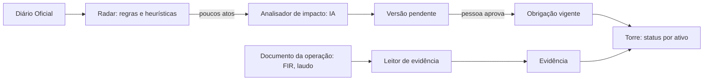

# Arquitetura e decisões

Este documento registra as decisões que já foram tomadas. Ele muda junto com o código.

## O produto em uma frase

Para cada ativo de uma empresa regulada, mostrar o que precisa ser entregue, até quando, por quê (qual artigo) e o que mudou desde ontem. Tudo se atualiza quando sai uma norma nova ou chega um documento da operação.

Mineração é a primeira vertical. O modelo de dados usa "ativo" e não "barragem", para que o mesmo motor atenda obras, equipamentos (QSMS) e licenças ambientais.

## Os dois fluxos

- **De cima para baixo:** norma → obrigações → o que cada ativo precisa fazer.
- **De baixo para cima:** documento da operação → evidência → obrigação cumprida.
- **Na torre:** cada obrigação de cada ativo aparece como 🟢 em dia, 🟡 vencendo, 🔴 atrasada ou sem evidência, ou 🔵 mudou (aguardando aprovação).

## Banco de dados: SQLite

| Critério | SQLite agora | Produção |
|---|---|---|
| Velocidade | Arquivo local, consultas em milissegundos | Postgres (RDS) |
| Agilidade | Zero infraestrutura, roda igual em toda máquina | |
| Custo | Zero | |

Todo acesso passa por `regulaia/db.py`. Trocar de banco mexe só nesse arquivo.

Ficou de fora o DynamoDB, que o primeiro rascunho sugeria. Os dados são relacionais (empresa → ativo → obrigação → versão → evidência → ato), e o DynamoDB complica esse tipo de consulta.

**Obrigações nunca são sobrescritas.** Cada mudança cria uma versão nova, ligada ao ato que a causou e ao trecho citado. Ela fica `pendente` até uma pessoa aprovar. Isso dá a comparação antes/depois, a resposta para "por que esse prazo é esse?" e o histórico de quem decidiu.

O cadastro inicial está em `seed_obligations.csv`, legível e revisável no GitHub. A coluna `regra` diz a quais ativos cada obrigação se aplica (a sintaxe está em `regulaia/regras.py`).

## Custo da IA: cada camada só passa adiante o que não conseguiu resolver

| Camada | O que faz | Custo |
|---|---|---|
| 0. Regras | Órgão, tipo de ato, regex de "art. X da Resolução Y", datas | Zero |
| 1. Busca por contexto | Acha quais obrigações o ato provavelmente toca (busca local por palavras e números de artigo) | Zero |
| 2. Modelo barato | Extrai a mudança em JSON, com o trecho citado | Centavos |
| 3. Modelo forte | Só quando o barato devolve baixa confiança ou o Python reprova a resposta | Raro |

Mais duas proteções:
- **Cache por conteúdo.** A tabela `analise_ia` guarda cada resposta pela chave sha256(tarefa + modelo + prompt + entrada). O mesmo ato nunca é pago duas vezes, e o custo total fica medido.
- **A IA nunca decide sozinha.** O Python confere se o trecho citado existe no ato e se o artigo bate com a obrigação, e uma pessoa aprova a mudança.

## Provedores de IA: troca por configuração

O código fala com uma interface única. Qual provedor e qual modelo atende cada tarefa fica num arquivo de configuração, e as chaves ficam no `.env`, nunca no GitHub.

| Camada | Padrão | Se não houver |
|---|---|---|
| 2. Modelo barato | DeepSeek V4.1 Flash via OpenCode Go (franquia do plano de US$ 10) | Claude Haiku (OpenCode Go ou Anthropic) |
| 3. Modelo forte | DeepSeek V4.1 Flash com raciocínio no máximo (`max`, mesma franquia) | Claude Sonnet, se houver chave da Anthropic ou Bedrock. Opus não: caro demais para o ganho |
| No evento | Claude 5 no Bedrock (a família 5.5 não estaria disponível lá) | O mesmo de antes, pela internet |

A OpenCode Go mistura dois formatos de API: alguns modelos usam o da OpenAI (`/chat/completions`, ex.: DeepSeek) e outros o da Anthropic (`/messages`, ex.: Haiku, Qwen). O código fala os dois, o que também cobre a Anthropic e a DeepSeek diretas. O Bedrock entra por um adaptador próprio (Converse).

**Conta do cliente (traga sua chave).** O provedor e a chave são configuração, não código. Uma empresa pode rodar a RegulaIA com a própria conta (Bedrock na AWS dela, Anthropic, DeepSeek), e os documentos dela não passam pela nossa conta. Para mineradoras, isso responde à pergunta "para onde vão meus dados?".

Os prompts não podem depender de um modelo específico. A saída é sempre JSON validado pelo Python, então trocar de modelo muda o custo e a qualidade, não o funcionamento.

Sobre o `AGENTS.md`: ele é uma convenção para agentes de programação (Codex, OpenCode, Claude Code) e não é lido por chamadas de API. O equivalente no nosso produto é o arquivo de configuração: ele manda a camada 2 usar um modelo barato (Haiku, DeepSeek) e só a camada 3 usar um forte (Sonnet).

## Fontes de dados

- O `robots.txt` de www.in.gov.br proíbe robôs. O radar usa os canais oficiais de acesso em lote: o XML mensal de dados abertos e o INLABS.
- A demo não depende de internet: os dados são processados antes e ficam em cache.
